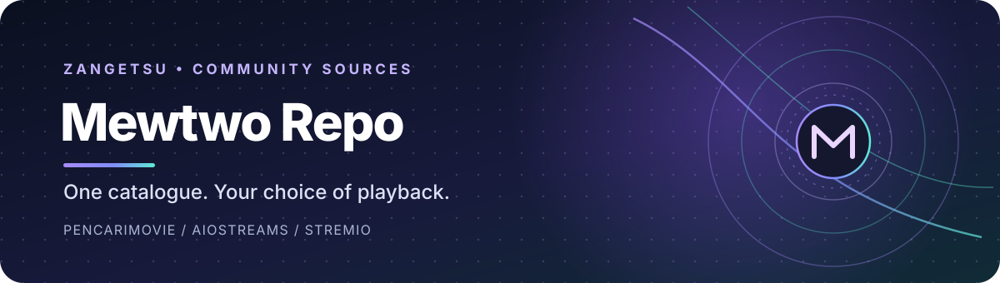
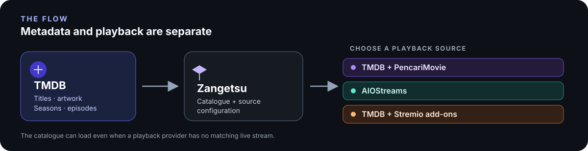
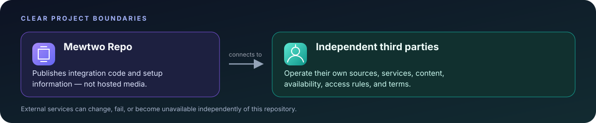

<p align="center">
  
</p>

<p align="center">
  <a href="https://github.com/Spyou/Zangetsu"></a>
  <a href="https://raw.githubusercontent.com/MewtwoOP1/Mewtwo-repo/main/index.json"></a>
  
</p>

<p align="center">
  <strong>Discover with TMDB. Play through the provider you choose.</strong><br />
  <sub>Community-maintained JavaScript sources for Zangetsu</sub>
</p>

<p align="center">
  <a href="#at-a-glance">Overview</a> &nbsp; · &nbsp;
  <a href="#add-the-repository">Install</a> &nbsp; · &nbsp;
  <a href="#choose-your-setup">Integrations</a> &nbsp; · &nbsp;
  <a href="#third-party-sources-and-responsibility">Third-party notice</a> &nbsp; · &nbsp;
  <a href="#troubleshooting">Troubleshooting</a>
</p>

---

## At a glance

This repository includes four integrations documented here. Choose one to get started; **you do not need to install all four**.

| Integration | Catalogue & metadata | Playback |
|:--|:--|:--|
|  **TMDB + PencariMovie** | TMDB | PencariMovie server |
|  **AIOStreams** | TMDB | Your AIOStreams instance |
|  **TMDB + Stremio** | TMDB | Your configured Stremio-compatible add-ons |
| **Zenkai Player** | AniMap + AniList metadata | External iframe only; no native Zangetsu playback |

<p align="center">
  
</p>

> [!IMPORTANT]
> **Metadata is not playback.** TMDB provides catalogue information such as titles, artwork, and episodes. Configured providers or add-ons supply playback results independently, and their availability may change at any time.

## Add the repository

In Zangetsu, open **Settings → Sources → Add repo**, paste the manifest URL below, and save it. Then install the integration you plan to use.

> **Copy the manifest URL:** Use the **Copy** control in the corner of the code block.

```text
https://raw.githubusercontent.com/MewtwoOP1/Mewtwo-repo/main/index.json
```

[Open the raw manifest](https://raw.githubusercontent.com/MewtwoOP1/Mewtwo-repo/main/index.json) · [Browse the repository](https://github.com/MewtwoOP1/Mewtwo-repo)

---

## Choose your setup

<details>
<summary> &nbsp; <strong>TMDB + PencariMovie</strong> &nbsp; <sub>Simple setup · default server included</sub></summary>

### What it does

TMDB powers search, catalogue browsing, title details, episode lists, artwork, and ratings. PencariMovie is queried separately for playback streams.

### Setup

1. Add this repository using the manifest URL above and install **TMDB + PencariMovie**.
2. Open **TMDB + PencariMovie → Settings**.
3. Configure the available fields:

   | Setting | Recommended value |
   |:--|:--|
   | **TMDB API Key** | Leave blank to use Zangetsu's built-in key. A personal TMDB v3 API key is optional. |
   | **PencariMovie server manifest URL** | The public default is prefilled. Leave it unchanged unless you have your own valid, tokenized `/manifest.json` URL. |
   | **Max streams per add-on** | Defaults to **25**; the available range is 5–100. |

4. Save your settings, search for a movie or series, open the title details, and choose a stream if one is available.

### If streams do not appear

- Check that the server manifest URL has not been cleared, truncated, or mistyped.
- Try another title. A title appearing in TMDB confirms catalogue lookup worked; it does not guarantee PencariMovie has a playable stream for that title.
- If the settings look correct, the upstream service may be temporarily unavailable.

</details>

<details>
<summary> &nbsp; <strong>AIOStreams</strong> &nbsp; <sub>Movies · series · anime indexed by TMDB</sub></summary>

### What it does

TMDB handles catalogue discovery and episode metadata. AIOStreams supplies playback results from the add-ons configured in your own instance. **Installing this source does not automatically import every Stremio add-on.**

### Get your manifest URL

1. Open your AIOStreams instance and configure the add-ons and stream sources you want.
2. Copy the personalized manifest URL supplied by your instance. It should follow this general pattern:

```text
https://YOUR-AIOSTREAMS-HOST/stremio/YOUR-ID/YOUR-CONFIG/manifest.json
```

Use the real URL from your instance. The URL above is only an example format.

### Configure it in Zangetsu

1. Install **AIOStreams** from this repository and open **AIOStreams → Settings**.
2. Review the settings:

   | Setting | What to enter |
   |:--|:--|
   | **AIOStreams Manifest URL** | Paste your full personalized manifest URL. Required. |
   | **AIOStreams UserData (base64)** | Optional. Use it only if your instance requires it. When provided, it takes precedence over Basic authentication. |
   | **TMDB API key or Read Access Token** | Optional. Leave blank to use Zangetsu's built-in TMDB key. |
   | **Show torrent / P2P streams** | Keep off unless your player supports magnet links. |
   | **Maximum concurrent requests** | Defaults to **5 simultaneous requests**. This limits concurrent requests, not the number of links returned. |
   | **AIOStreams request timeout** | Defaults to **9 seconds** for each stream search, including ID fallback attempts. |
   | **Total stream lookup deadline** | Defaults to **12 seconds** across stream lookup and anime ID mapping. |

3. Save your settings, search through AIOStreams in Zangetsu, open a title from this source, and try playback.

### If results are slow or missing

- Recheck the manifest URL, including the `/stremio/.../manifest.json` path.
- If TMDB returns no streams for an anime episode, the provider now checks AIOStreams' anime database mapping and retries with available MAL, AniList, Kitsu, AniDB, IMDb, or TVDB IDs.
- Confirm the relevant add-ons are enabled and working inside your AIOStreams instance.
- Review per-add-on timeout settings in AIOStreams. A longer client-side timeout cannot make a slow upstream add-on respond faster.
- Treat personalized manifest URLs and UserData values as private if they contain account-specific identifiers or access credentials. **Do not publish them.**

</details>

<details>
<summary> &nbsp; <strong>TMDB + Stremio</strong> &nbsp; <sub>Connect compatible add-ons</sub></summary>

### What it does

TMDB provides search, title details, catalogue metadata, and episode information. Playback results are requested from the Stremio-compatible add-ons you configure.

### Setup

1. Install **TMDB + Stremio** from this repository, then open **TMDB + Stremio → Settings**.
2. In **Streaming Add-on URLs**, paste the manifest URL for each compatible add-on that provides playback streams. Enter multiple URLs separated by commas or on separate lines. Keep required URL paths and query tokens intact.

   Example format — replace these with your actual streaming add-on URLs:

   ```text
   https://addon-one.example/manifest.json
   https://addon-two.example/manifest.json
   ```

3. To use a separate catalogue or metadata add-on, paste its manifest URL into **Metadata Add-on URLs**. Enable **Use metadata add-on catalogues** to browse those catalogues and prefer their title metadata. This is independent of Streaming Add-on URLs. If Metadata Add-on URLs is blank, the provider falls back to the streaming list for compatibility.

   Example format:

   ```text
   https://metadata-addon.example/manifest.json
   ```

4. Review the remaining options:

   | Setting | Recommended value |
   |:--|:--|
   | **TMDB API Key** | Leave blank to use Zangetsu's built-in key. A personal TMDB v3 API key is optional. |
   | **Use metadata add-on catalogues** | Off by default. Enable it to use catalogues from configured metadata add-ons instead of TMDB catalogues. |
   | **Max streams per add-on** | Defaults to **25** streams considered per streaming add-on; the available range is 5–100. |
   | **Show torrent / P2P streams** | Off by default. Enable only if Zangetsu's player supports magnet links. |

5. Save your settings, search for a movie or series, open it from **TMDB + Stremio**, and choose a returned stream.

### If no streams are returned

- Confirm each URL is valid and points to a Stremio-compatible add-on that provides the `stream` resource.
- Check whether the add-on requires a specific configuration, access token, or URL path.
- Confirm the add-on supports streams for that title and episode. Catalogue entries can appear even when no configured add-on has a matching stream.
- Anime add-ons may require MAL, AniList, Kitsu, IMDb, TVDB, or their own ID format. The resolver uses only identifiers present in metadata and does not invent missing anime-ID mappings.
- Torrent results are hidden by default. Enable **Show torrent / P2P streams** only when the player supports magnet links.
- One failed add-on request does not necessarily stop other configured add-ons from returning results.

</details>

---


<details>
<details>
<summary><strong>Zenkai Player</strong> · Fast AniList metadata and Zenkaii external-player links</summary>

### What it does

AniMap supplies title search and cross-service mappings. AniList metadata is fetched only when a title is opened, rather than once for every search result. Complete AniList records are returned directly; MAL is queried only when a long-running show's episode count is missing.

The generated browser-player URL uses:

```text
https://zenkaii.pages.dev/embed?id={ANILIST_ID}&ep={EPISODE}&server={SERVER}&audio={AUDIO}
```

### Metadata performance

- Search uses one AniMap title-index request and maps its returned AniList IDs locally. It does not fan out into one metadata request per result.
- Detail pages normally need one AniMap parsed-record request. A second mapping/MAL lookup occurs only when the parsed record is missing or has no usable episode count.
- AniList GraphQL is a fallback only when AniMap cannot resolve the title or detail. Requests are cached, deduplicated, serialized, and cooled down after 429 or host-side rate-limit errors.
- MAL supplies missing episode totals for ongoing long-running anime. Episode lists are capped at 20,000.
- AniMap documents [title search](https://animap.id/docs/search), [AniList records](https://animap.id/docs/anilist), and [AniList/MAL mappings](https://animap.id/docs/map).

### Playback compatibility (important)

Zenkaii's public playback interface is an HTML player embed. Its public `/api/servers` route reports availability, but its `/api/stream` route explicitly rejects external direct-stream extraction and directs clients to use `/embed`. See the [upstream API handler](https://github.com/nyyrox2/Zenkai/blob/main/server/handler.js).

Zangetsu currently expects a native media URL (HLS, MP4, or torrent) from a provider. It downloads the Zenkaii HTML embed page and cannot decode it as video, which produces **“Failed to recognize file format.”** The provider therefore no longer returns the iframe URL as a fake playable source. It exposes the embed URL for a browser/WebView-capable host and returns no native stream, allowing other installed providers to be tried.

**Native Zenkai playback inside Zangetsu cannot be enabled by changing Mewtwo Repo alone.** It requires iframe/WebView support in the app. No private API or origin restriction is bypassed by this integration.

</details>

## Troubleshooting

| Symptom | First thing to check |
|:--|:--|
| Titles load, but no playable links appear | Provider status, manifest URL, and stream availability |
| AIOStreams times out | AIOStreams per-add-on timeouts, then the source timeout settings |
| A series opens, but an episode has no results | Season and episode selection, plus add-on support for series streams |
| One Stremio add-on fails while others work | That add-on's URL and configuration; the other add-ons may still return results |
| TMDB fails after previously working | Recent API responses can be served from cache during transient network failures; check DNS/network access if all requests still fail |
| The app says AniList is having an error | AniList is the app's built-in metadata service, not this repository's stream provider. If AniList is unavailable, switch the anime metadata provider to MyAnimeList if available, or retry when the service/network recovers |

## Third-party sources and responsibility

<p align="center">
  
</p>

The sources and services referenced by these integrations are third-party projects or endpoints made available by their respective operators. **Mewtwo Repo does not own, operate, maintain, host, or control those third-party sources.** This repository publishes integration code and configuration information only.

| This repository provides | This repository does not provide |
|:--|:--|
| Integration code and a source manifest | Hosted, uploaded, stored, or distributed media files |
| Setup information for supported integrations | Operation or maintenance of third-party source websites and services |
| References to externally operated services | Guarantees about third-party content, links, stream availability, or uptime |

> [!WARNING]
> **Third-party services are outside this project's control.** We do not verify, control, or guarantee the content, accuracy, legality, licensing, availability, security, or data-handling practices of external sources. Services, URLs, and returned results may change or stop working without notice. To the extent permitted by applicable law, the maintainers are not responsible for third-party services, their content, outages, or how external services are used.
>
> You choose whether to access third-party sources and are responsible for complying with applicable laws and each service's terms. A link or integration listed here is not an endorsement or a guarantee of availability.

## Project boundaries & licensing

- This repository and its maintainers do **not** host, upload, store, proxy, or distribute movies, series, anime, subtitles, or video files.
- Metadata, artwork, and playback links are returned by TMDB or external services. Those services determine their own availability, access rules, terms, and policies.
- This is an unofficial community project, not affiliated with or endorsed by Zangetsu, TMDB, Stremio, AIOStreams, or PencariMovie.
- Most code is licensed under MIT. The MovieBox IN port is separately licensed under GPL-3.0-only. See [LICENSE](LICENSE) and [LICENSES/GPL-3.0.txt](LICENSES/GPL-3.0.txt).

## Credits

The provider manifest and JavaScript interface follow the self-contained source model documented by [Spyou/zangetsu-providers](https://github.com/Spyou/zangetsu-providers). This repository is independently maintained and is not the official Zangetsu provider repository.

<p align="center">
  <sub>Unofficial community integrations · Third-party services are independently operated · Keep personalized manifests private</sub>
</p>

<p align="center">
  <a href="#at-a-glance">Back to top ↑</a>
</p>
