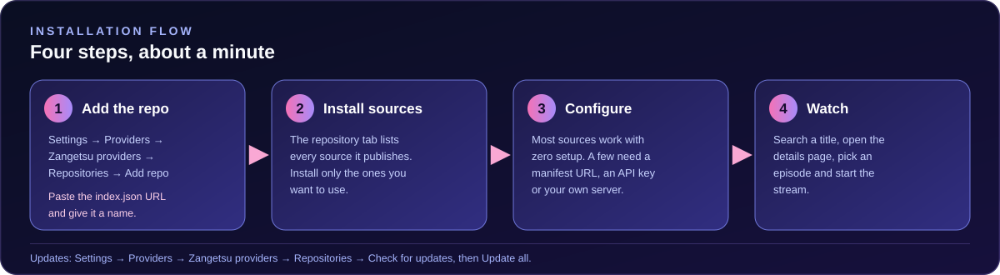
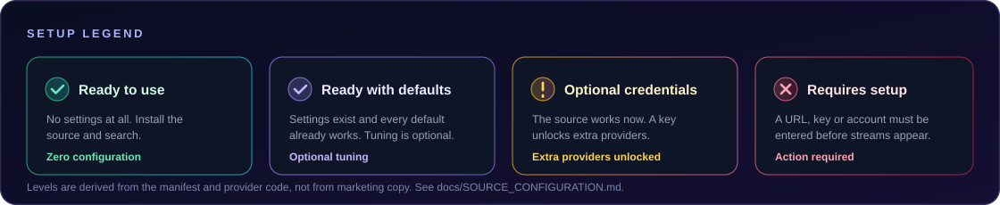
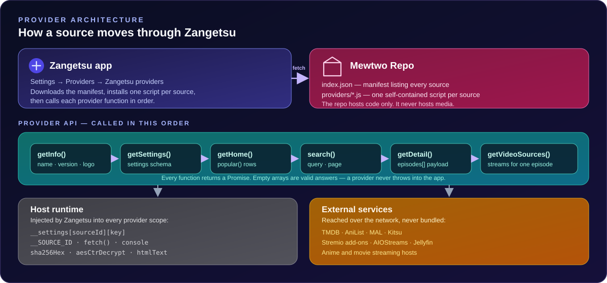
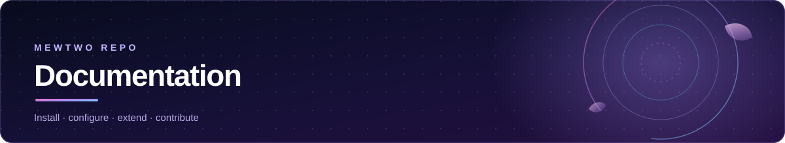

<p align="center">
  
</p>

<p align="center">
  <a href="docs/EXTENSIONS.md"></a>
  <a href="docs/README.md#licensing"></a>
  <a href="https://github.com/MewtwoOP1/Mewtwo-repo/actions/workflows/test.yml"></a>
  <a href="https://github.com/MewtwoOP1/Mewtwo-repo/stargazers"></a>
  <a href="https://github.com/Spyou/Zangetsu"></a>
</p>

<p align="center">
  <strong>Find the title with one source. Play it through another.</strong><br />
  <sub>Twenty-six hand-tuned JavaScript sources for the <a href="https://github.com/Spyou/Zangetsu">Zangetsu</a> app — installed by URL, updated in place, no app rebuild.</sub>
</p>

<p align="center">
  <a href="#what-this-is">Overview</a> &nbsp;·&nbsp;
  <a href="#install-in-one-minute">Install</a> &nbsp;·&nbsp;
  <a href="#pick-the-sources-you-want">Sources</a> &nbsp;·&nbsp;
  <a href="#documentation">Docs</a> &nbsp;·&nbsp;
  <a href="#troubleshooting">Help</a> &nbsp;·&nbsp;
  <a href="#contributing">Contribute</a>
</p>

---

## What this is

**Mewtwo Repo** is a source repository for the [Zangetsu](https://github.com/Spyou/Zangetsu) app on Android, Android TV and iOS. It publishes **26 independent sources** — each one a self-contained JavaScript file that the app downloads, installs and runs at runtime.

You add one repository URL to the app, then install only the sources you actually want. Thirteen of them work with **zero configuration**: no API key, no account, no second server.

<p align="center">
  
</p>

> [!IMPORTANT]
> **This repository hosts code, not media.** Every stream is fetched at request time from a third-party service that is independently operated, changes its own domains, and can go offline without notice. Nothing here is guaranteed to keep working, and no provider here should be treated as a permanent promise.

---

## At a glance

| | |
|:--|:--|
| **Published sources** | 26 — 19 anime, 7 movie and TV |
| **Expose no settings at all** | 13 sources |
| **Settings that all have working defaults** | 8 sources |
| **Optional keys that unlock extra hosts** | 2 sources |
| **Must be configured before streams appear** | 2 sources |
| **Require your own server and login** | 1 source |
| **Languages** | English (20), Hindi (4), Spanish (1), multi-language (1) |
| **NSFW-flagged sources** | 0 — every source in the manifest is marked `nsfw: false` |
| **Verified against** | Zangetsu v2.3.5 |
| **Licence** | MIT, with one file under GPL-3.0 — see [Licensing](#licensing) |

---

## Key features

| | |
|:--|:--|
| **One URL installs the lot** | The app reads a single `index.json` manifest and lists every source it publishes. You pick the ones you want. |
| **Metadata and playback are separate** | TMDB, AniList or the site's own API supplies the catalogue. Streams come from the provider you chose — or from *your* add-ons, *your* AIOStreams instance or *your* Jellyfin server. |
| **No API key for most sources** | Sessions, cookies, tokens and decryption are handled inside the provider. You never have to paste a key for the majority of the catalogue. |
| **Resilient by design** | Multi-host rotation, multi-server fallback, request de-duplication, TTL caches and per-provider timeouts keep a single dead host from emptying a whole list. |
| **Plain JavaScript** | Every source is one readable `.js` file with no build step, no bundler and no runtime dependencies. |
| **Continuously verified** | A CI workflow validates every provider against the manifest and runs the whole test suite on each push and pull request. |

---

## Supported apps and compatibility

This repository publishes **Zangetsu JavaScript sources** — the format the Zangetsu app loads at runtime. Nothing here is an Android extension, an Aniyomi extension or a CloudStream extension.

| Platform | Zangetsu build | These sources |
|:--|:--|:--|
| Android phone & tablet | [Zangetsu v2.3.5 APK](https://github.com/Spyou/Zangetsu/releases/latest) | Supported |
| Android TV | `Zangetsu-v*-tv.apk` from the same release | Supported |
| iOS / iPadOS (beta) | `Zangetsu-v*-ios.ipa` from the same release | Supported — Zangetsu's own JavaScript sources work on iOS, unlike CloudStream, Aniyomi or Mihon extensions |
| Windows | in progress upstream | Not yet |

**Requirements**

- A Zangetsu build that supports JavaScript source repositories — verified against **v2.3.5**.
- An internet connection. Every source is a live scraper or API client.
- For the three sources that require one: your own Stremio add-on URL, your own AIOStreams instance, or your own Jellyfin-compatible server.

Get the app from the [Zangetsu releases page](https://github.com/Spyou/Zangetsu/releases/latest). Use the `arm64-v8a` APK on a modern phone, `tv` on Android TV, or the `universal` build if you are unsure.

---

<p align="center">
  
</p>

## Install in one minute

<p align="center">
  
</p>

**1 — Add the repository.** In Zangetsu open **Settings → Providers → Zangetsu providers → Repositories → Add repo**, paste the manifest URL and save it.

> On older Zangetsu builds the same screen is reached through **Settings → Sources → Add repo**.

```text
https://raw.githubusercontent.com/MewtwoOP1/Mewtwo-repo/main/index.json
```

**2 — Install what you want.** The repository tab now lists every source this repo publishes. Tap **Install** on the ones you want — you never have to install all 26.

**3 — Configure only what asks for it.** Most sources need nothing. A handful need a manifest URL, an add-on list or your server details. Every one of them is flagged in [the source catalogue](docs/EXTENSIONS.md) and explained in [the configuration guide](docs/SOURCE_CONFIGURATION.md).

**4 — Search and play.** Open search, pick a title, open the details page, choose an episode and start the stream.

Full walkthrough with troubleshooting: **[Installation guide](docs/INSTALLATION.md)** · **[Getting started](docs/GETTING_STARTED.md)**

---

## Pick the sources you want

Setup levels are derived from the provider code, not from marketing copy.

<p align="center">
  
</p>

| Source | Type | Setup | What you have to do |
|:--|:--|:--|:--|
| **Jellyfin** | movie | 🔴 Account or server | Server address plus a login, or an API key |
| **AIOStreams** | movie | 🟠 Configuration | Your personalised `/stremio/…/manifest.json` URL |
| **TMDB + Stremio** | movie | 🟠 Configuration | At least one add-on manifest URL |
| **Mewstream** | movie | 🟡 Optional credentials | Nothing — a Showbox token unlocks one extra host |
| **CineStream** | movie | 🟡 Optional credentials | Nothing — each key unlocks one specific host |
| **TMDB + PencariMovie** | movie | 🔵 Defaults work | Nothing — the public server URL is prefilled |
| **Miruro** | anime | 🔵 Defaults work | Nothing — three API mirrors and the server order are prefilled |
| **Zenkai Player** | anime | 🔵 Defaults work | Nothing — pick a server if the default is not to your taste |
| **AnimeOnsen** | anime | 🔵 Defaults work | Nothing |
| **AnimeGG** | anime | 🔵 Defaults work | Nothing |
| **AnimeAV1** | anime | 🔵 Defaults work | Nothing |
| **AnimeKai (Unoriginal)** | anime | 🔵 Defaults work | Nothing |
| **AniWave (Unoriginal)** | anime | 🔵 Defaults work | Nothing |
| **AnimeSuge, AniKoto, AnimeSalt, DesiDub Anime, AnimeParadise, AnV, HiAnime, AniChan, HDHub4u, MegaPlay, MMani, AniZone, RareAnimes** | anime / movie | 🟢 Ready to use | Nothing at all — these expose no settings |

The complete inventory, with versions, setting keys, behaviour notes and known limitations for all 26 sources, lives in **[docs/EXTENSIONS.md](docs/EXTENSIONS.md)**.

---

## How it works

<p align="center">
  
</p>

A source is a single JavaScript file that implements a small, fixed contract:

| Call | Returns |
|:--|:--|
| `getInfo()` | The source's name, version, type, language and logo |
| `getSettings()` | The settings schema the app renders as a configuration form |
| `getHome(opts)` / `popular(opts)` | Rows of catalogue items |
| `search(query, page, opts)` | Matching catalogue items |
| `getDetail(url, opts)` | One title, including its episode list |
| `getEpisodes(url, opts)` | The episode list for a title |
| `getVideoSources(episodeUrl, opts)` | Playable stream URLs for one episode |

The app injects `__settings`, `__SOURCE_ID`, a `fetch()` helper with a `timeoutMs` option and a handful of crypto and HTML helpers. A provider never blocks the UI and never throws into the app — a failed lookup is simply an empty result.

Full detail: **[Architecture guide](docs/ARCHITECTURE.md)**

---

<p align="center">
  
</p>

## Documentation

<p align="center">
  
</p>

| Guide | What it answers |
|:--|:--|
| **[Installation](docs/INSTALLATION.md)** | How to add the repository, install sources, update them and confirm it worked |
| **[Getting started](docs/GETTING_STARTED.md)** | The whole journey from install to your first episode, written for first-time users |
| **[Source catalogue](docs/EXTENSIONS.md)** | Every source, its version, settings, behaviour and limitations |
| **[Source configuration](docs/SOURCE_CONFIGURATION.md)** | Which sources need what, where to type it, how to test it and how to recover from a bad value |
| **[Architecture](docs/ARCHITECTURE.md)** | How the manifest, the providers, the runtime and the network fit together |
| **[Development](docs/DEVELOPMENT.md)** | Repository layout, tooling, the provider contract and the local test loop |
| **[Troubleshooting](docs/TROUBLESHOOTING.md)** | Symptom-by-symptom fixes, and how to tell an upstream problem from a real bug |
| **[FAQ](docs/FAQ.md)** | The questions that come up again and again |
| **[Contributing](CONTRIBUTING.md)** | How to propose, build and ship a change |
| **[Security policy](SECURITY.md)** | How to report a vulnerability responsibly |

---

## Troubleshooting

| Symptom | First thing to check |
|:--|:--|
| The repository does not appear after adding it | The URL must end in `index.json` — not a single `.js` file. See [Installation](docs/INSTALLATION.md#the-repository-does-not-appear) |
| Titles load but no streams appear | The playback half is separate from the catalogue. Check that the source's own configuration is complete |
| AIOStreams returns an error | The personalised manifest URL is empty or truncated. See [AIOStreams setup](docs/SOURCE_CONFIGURATION.md#aiostreams) |
| One Stremio add-on fails while others work | That add-on's URL or its own configuration. The others keep working |
| An API key or token is rejected | Keys expire and get revoked. Re-copy it from the provider's own site |
| A source used to work and now returns nothing | The upstream site changed its markup or its domain. See [Troubleshooting](docs/TROUBLESHOOTING.md) |
| The app reports an AniList error | AniList is the app's own metadata service, not a source from this repository. Retry, or switch the app's anime metadata provider |

Zangetsu also has a built-in **Settings → Providers → Source health** screen that tests each installed source and tells you which ones are alive. Start there before opening an issue.

Full guide: **[Troubleshooting](docs/TROUBLESHOOTING.md)** · **[FAQ](docs/FAQ.md)**

---

## Contributing

New sources, bug fixes and documentation improvements are all welcome.

1. Read **[docs/DEVELOPMENT.md](docs/DEVELOPMENT.md)** and **[CONTRIBUTING.md](CONTRIBUTING.md)**.
2. Add or change a provider in `providers/`, then mirror the change in `index.json` — the manifest and the provider must agree on name, version, type, language, logo and settings.
3. Run `node scripts/check-and-run.mjs`. It validates the manifest against every provider and runs the whole test suite.
4. Open a pull request against `main`.

Every pull request runs the same validation in CI, so a green local run means a green build.

---

<p align="center">
  
</p>

## Credits and acknowledgements

This project exists because of the people who built it and the projects it stands on.

- **[Zangetsu](https://github.com/Spyou/Zangetsu)** — the app these sources run in, by Krishna Vishwakarma. Licensed under GPL-3.0.
- **[zangetsu-providers](https://github.com/Spyou/zangetsu-providers)** — the upstream provider repository whose flow and several adapter patterns this work follows.
- **[Yuzono anime-extensions](https://github.com/yuzono/anime-extensions)** — the Apache-2.0 project that the AnimeKai and AniWave providers are derived from.
- **[CineStream CloudStream extension](https://github.com/SaurabhKaperwan/CSX/tree/master/CineStream)** by megix — the GPL-3.0 project the CineStream source is a derivative of.
- **[Jellyfin](https://github.com/jellyfin/jellyfin-ux)** — the official Jellyfin icon is used to identify Jellyfin compatibility, under [CC BY-SA 4.0](https://github.com/jellyfin/jellyfin-ux/blob/master/LICENSE).

Every third-party service these sources talk to is operated by somebody else. A full, file-by-file breakdown is in **[THIRD_PARTY_NOTICES.md](THIRD_PARTY_NOTICES.md)**.

---

## Licensing

Mewtwo Repo is **not** covered by a single licence, and this section says exactly what applies where.

| Component | Licence | File |
|:--|:--|:--|
| Original repository code, tests, scripts, documentation | **MIT** | [LICENSE](LICENSE) |
| `providers/serenity-animekai.js`, `providers/serenity-aniwave.js` | **Apache-2.0** | [LICENSE-APACHE-2.0](LICENSE-APACHE-2.0) · [NOTICE-YUZONO-ANIME-EXTENSIONS.md](NOTICE-YUZONO-ANIME-EXTENSIONS.md) |
| `providers/cinestream.js` | **GPL-3.0** | [LICENSE-CINESTREAM.md](LICENSE-CINESTREAM.md) · [NOTICE-CINESTREAM.md](NOTICE-CINESTREAM.md) |

The GPL-3.0 file is a derivative work of the CineStream CloudStream extension and remains GPL-3.0. It does **not** relicense any other file in this repository, and the MIT files are not relicensed by it. Third-party notices are preserved in full and are listed in [THIRD_PARTY_NOTICES.md](THIRD_PARTY_NOTICES.md).

---

## Project links

| | |
|:--|:--|
| **Repository** | [github.com/MewtwoOP1/Mewtwo-repo](https://github.com/MewtwoOP1/Mewtwo-repo) |
| **Manifest** | [index.json](https://raw.githubusercontent.com/MewtwoOP1/Mewtwo-repo/main/index.json) |
| **The app** | [github.com/Spyou/Zangetsu](https://github.com/Spyou/Zangetsu) · [zangetsu.online](https://zangetsu.online) |
| **Upstream providers** | [github.com/Spyou/zangetsu-providers](https://github.com/Spyou/zangetsu-providers) |
| **Changes** | [CHANGELOG.md](CHANGELOG.md) |

---

<p align="center">
  <sub>Unofficial community integrations. No media is hosted here, and every connected service is independently operated. Users are responsible for how they use third-party sources and for complying with the law that applies to them.</sub>
</p>

<p align="center">
  
</p>

<p align="center">
  <a href="#what-this-is">Back to top ↑</a>
</p>
