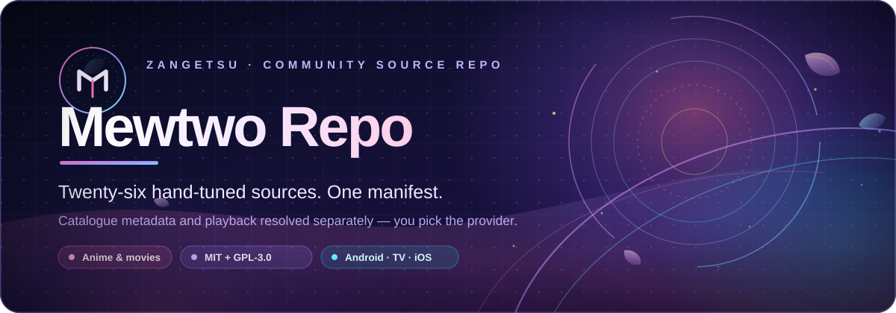
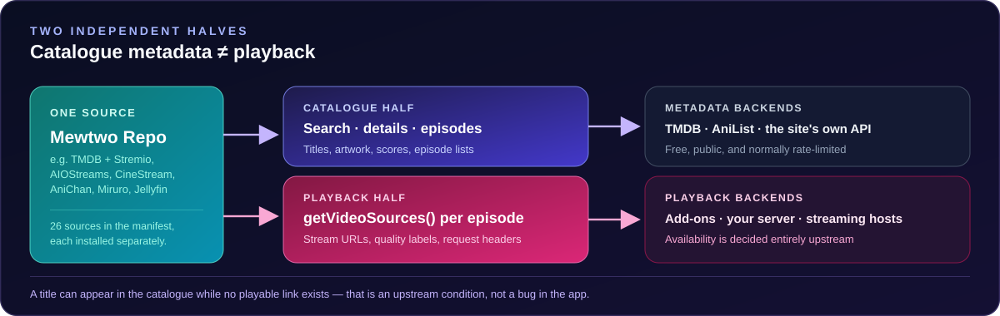

<p align="center">
  
</p>

<p align="center">
  <a href="https://github.com/Spyou/Zangetsu"></a>
  <a href="https://raw.githubusercontent.com/MewtwoOP1/Mewtwo-repo/main/index.json"></a>
  
</p>

<p align="center">
  <strong>Discover with TMDB. Play through the provider you choose.</strong><br />
  <sub>Community-maintained JavaScript sources for Zangetsu</sub>
</p>

<p align="center">
  <a href="#at-a-glance">Overview</a> &nbsp; · &nbsp;
  <a href="#add-the-repository">Install</a> &nbsp; · &nbsp;
  <a href="#choose-your-setup">Integrations</a> &nbsp; · &nbsp;
  <a href="#credits-and-licensing">Credits &amp; licensing</a> &nbsp; · &nbsp;
  <a href="#troubleshooting">Troubleshooting</a>
</p>

---

## At a glance

This repository documents six main integrations and a set of individual anime sources. Choose the sources you need; **you do not need to install all of them**.

| Integration | Catalogue & metadata | Playback |
|:--|:--|:--|
|  **TMDB + PencariMovie** | TMDB | PencariMovie server |
|  **AIOStreams** | TMDB | Your AIOStreams instance |
|  **TMDB + Stremio** | TMDB | Your configured Stremio-compatible add-ons |
| **Miruro** | Miruro / AniList metadata | Available Miruro streaming servers |
| **Zenkai Player** | AniMap + AniList metadata | Native MegaPlay, VidStream, and ACDN multi-audio playback |
| **AniChan** | AniList metadata | AniChan HLS servers |
|  **Jellyfin** | Jellyfin libraries and server metadata | Jellyfin or AIOStreams media server |

<p align="center">
  
</p>

> [!IMPORTANT]
> **Metadata is not playback.** TMDB provides catalogue information such as titles, artwork, and episodes. Configured providers or add-ons supply playback results independently, and their availability may change at any time.

## Add the repository

In Zangetsu, open **Settings → Sources → Add repo**, paste the manifest URL below, and save it. Then install the integration you plan to use.

> **Copy the manifest URL:** Use the **Copy** control in the corner of the code block.

```text
https://raw.githubusercontent.com/MewtwoOP1/Mewtwo-repo/main/index.json
```

[Open the raw manifest](https://raw.githubusercontent.com/MewtwoOP1/Mewtwo-repo/main/index.json) · [Browse the repository](https://github.com/MewtwoOP1/Mewtwo-repo)

---

## Choose your setup

<details>
<summary> &nbsp; <strong>TMDB + PencariMovie</strong> &nbsp; <sub>Simple setup · default server included</sub></summary>

### What it does

TMDB powers search, catalogue browsing, title details, episode lists, artwork, and ratings. PencariMovie is queried separately for playback streams.

### Setup

1. Add this repository using the manifest URL above and install **TMDB + PencariMovie**.
2. Open **TMDB + PencariMovie → Settings**.
3. Configure the available fields:

   | Setting | Recommended value |
   |:--|:--|
   | **TMDB API Key** | Leave blank to use Zangetsu's built-in key. A personal TMDB v3 API key is optional. |
   | **PencariMovie server manifest URL** | The public default is prefilled. Leave it unchanged unless you have your own valid, tokenized `/manifest.json` URL. |
   | **Max streams per add-on** | Defaults to **25**; the available range is 5–100. |

4. Save your settings, search for a movie or series, open the title details, and choose a stream if one is available.

### If streams do not appear

- Check that the server manifest URL has not been cleared, truncated, or mistyped.
- Try another title. A title appearing in TMDB confirms catalogue lookup worked; it does not guarantee PencariMovie has a playable stream for that title.
- If the settings look correct, the upstream service may be temporarily unavailable.

</details>

<details>
<summary> &nbsp; <strong>AIOStreams</strong> &nbsp; <sub>Movies · series · anime indexed by TMDB</sub></summary>

### What it does

TMDB handles catalogue discovery and episode metadata. AIOStreams supplies playback results from the add-ons configured in your own instance. **Installing this source does not automatically import every Stremio add-on.**

### Get your manifest URL

1. Open your AIOStreams instance and configure the add-ons and stream sources you want.
2. Copy the personalized manifest URL supplied by your instance. It should follow this general pattern:

```text
https://YOUR-AIOSTREAMS-HOST/stremio/YOUR-ID/YOUR-CONFIG/manifest.json
```

Use the real URL from your instance. The URL above is only an example format.

### Configure it in Zangetsu

1. Install **AIOStreams** from this repository and open **AIOStreams → Settings**.
2. Review the settings:

   | Setting | What to enter |
   |:--|:--|
   | **AIOStreams Manifest URL** | Paste your full personalized manifest URL. Required. |
   | **AIOStreams UserData (base64)** | Optional. Use it only if your instance requires it. When provided, it takes precedence over Basic authentication. |
   | **TMDB API key or Read Access Token** | Optional. Leave blank to use Zangetsu's built-in TMDB key. |
   | **Show torrent / P2P streams** | Keep off unless your player supports magnet links. |
   | **Maximum concurrent requests** | Defaults to **5 simultaneous requests**. This limits concurrent requests, not the number of links returned. |
   | **AIOStreams request timeout** | Defaults to **9 seconds** for each stream search, including ID fallback attempts. |
   | **Total stream lookup deadline** | Defaults to **12 seconds** across stream lookup and anime ID mapping. |

3. Save your settings, search through AIOStreams in Zangetsu, open a title from this source, and try playback.

### If results are slow or missing

- Recheck the manifest URL, including the `/stremio/.../manifest.json` path.
- If TMDB returns no streams for an anime episode, the provider now checks AIOStreams' anime database mapping and retries with available MAL, AniList, Kitsu, AniDB, IMDb, or TVDB IDs.
- Confirm the relevant add-ons are enabled and working inside your AIOStreams instance.
- Review per-add-on timeout settings in AIOStreams. A longer client-side timeout cannot make a slow upstream add-on respond faster.
- Treat personalized manifest URLs and UserData values as private if they contain account-specific identifiers or access credentials. **Do not publish them.**

</details>

<details>
<summary> &nbsp; <strong>TMDB + Stremio</strong> &nbsp; <sub>Connect compatible add-ons</sub></summary>

### What it does

TMDB provides search, title details, catalogue metadata, and episode information. Playback results are requested from the Stremio-compatible add-ons you configure.

### Setup

1. Install **TMDB + Stremio** from this repository, then open **TMDB + Stremio → Settings**.
2. In **Streaming Add-on URLs**, paste the manifest URL for each compatible add-on that provides playback streams. Enter multiple URLs separated by commas or on separate lines. Keep required URL paths and query tokens intact.

   Example format — replace these with your actual streaming add-on URLs:

   ```text
   https://addon-one.example/manifest.json
   https://addon-two.example/manifest.json
   ```

3. To use a separate catalogue or metadata add-on, paste its manifest URL into **Metadata Add-on URLs**. Enable **Use metadata add-on catalogues** to browse those catalogues and prefer their title metadata. This is independent of Streaming Add-on URLs. If Metadata Add-on URLs is blank, the provider falls back to the streaming list for compatibility.

   Example format:

   ```text
   https://metadata-addon.example/manifest.json
   ```

4. Review the remaining options:

   | Setting | Recommended value |
   |:--|:--|
   | **TMDB API Key** | Leave blank to use Zangetsu's built-in key. A personal TMDB v3 API key is optional. |
   | **Use metadata add-on catalogues** | Off by default. Enable it to use catalogues from configured metadata add-ons instead of TMDB catalogues. |
   | **Max streams per add-on** | Defaults to **25** streams considered per streaming add-on; the available range is 5–100. |
   | **Show torrent / P2P streams** | Off by default. Enable only if Zangetsu's player supports magnet links. |

5. Save your settings, search for a movie or series, open it from **TMDB + Stremio**, and choose a returned stream.

### If no streams are returned

- Confirm each URL is valid and points to a Stremio-compatible add-on that provides the `stream` resource.
- Check whether the add-on requires a specific configuration, access token, or URL path.
- Confirm the add-on supports streams for that title and episode. Catalogue entries can appear even when no configured add-on has a matching stream.
- Anime add-ons may require MAL, AniList, Kitsu, IMDb, TVDB, or their own ID format. The resolver uses only identifiers present in metadata and does not invent missing anime-ID mappings.
- Torrent results are hidden by default. Enable **Show torrent / P2P streams** only when the player supports magnet links.
- One failed add-on request does not necessarily stop other configured add-ons from returning results.

</details>

---


<details>
<summary><strong>Miruro</strong> · Multi-server anime catalogue and playback</summary>

### What it does

Miruro provides anime search, metadata, episode lists, sub/dub tracks, and playback sources from the available Miruro server pool. Episodes are grouped by number, so multiple servers can be tried for the same episode without creating duplicate episode rows.

### Settings

Open **Miruro → Settings** after installing it.

| Setting | What it controls |
|:--|:--|
| **API mirror URLs** | Ordered, comma- or newline-separated JSON API hosts. The defaults are prefilled. You can replace them with your own compatible API deployment. |
| **Streaming server priority** | Comma-separated provider IDs. Unlisted servers remain available after the listed servers. |
| **Disabled streaming servers** | Comma-separated IDs to exclude from the episode list and playback fallback. |
| **Audio tracks** | Show both SUB and DUB, or filter to one track. |
| **Automatic server fallback** | Try the next server when a server returns no playable links or fails. |
| **Maximum server attempts per episode** | Limit fallback to 3, 5, 8, or up to 14 servers. |
| **API request timeout** | Timeout for each API host request: 8, 15, or 25 seconds. |
| **Preferred video quality** | Automatic, 1080p, 720p, 480p, or 360p. Other returned qualities remain available. |
| **Home sections** | Choose spotlight, trending, recent, popular, and upcoming sections. |
| **Show adult catalogue entries** | Off by default. |
| **Metadata and episode cache** | Disable caching or use a 1, 2, or 5 minute in-memory cache. |

### Fallback behaviour

For each API request, Miruro rotates through the configured API hosts when a host is blocked, unavailable, rate-limited, times out, returns an API error, or produces invalid JSON. During playback it tries the watch endpoint first, then the quality-aware stream endpoint, then the detailed sources endpoint. When those routes cannot produce a playable source, it moves to the next available Miruro server for the same episode, subject to the configured attempt limit.

### Availability

Miruro and its JSON API hosts are independently operated services. A title can have metadata and episode entries while one or more playback servers are unavailable or have no stream for that episode. API-host rotation and server fallback improve resilience but cannot guarantee a playable link for every title.

</details>

---

<details>
<summary><strong>Zenkai Player</strong> · AniMap metadata and native direct playback</summary>

### Metadata

AniMap supplies title search and cached AniList/MAL metadata. Search does not issue per-result detail requests. Missing long-running episode totals use MAL and the raw AniList next-airing record where available.

### Playback

- **MegaPlay:** direct AniList-ID player route, player `data-id`, `getSources`, AES-CBC decode, HLS/MP4 result.
- **VidStream:** same direct-source resolution flow with its VidStream server code.
- **ACDN:** calls Zenkai's `/api/stream?server=acdn` route using the `X-Zenkai-Embed` marker. Zenkai performs the AniList-to-AnimeSalt mapping and returns a multi-audio HLS playlist. When its segment-proxy URL wraps a signed CDN playlist, the provider now offers that CDN playlist first with the extracted upstream Referer, then keeps Zenkai's proxy as a fallback. This avoids depending exclusively on the proxy layer that timed out during native playback in the supplied log.
- **FlixCloud:** falls back to the supported direct MegaPlay/VidStream resolvers until a separate public direct FlixCloud resolver is available.

ACDN's route is different from MegaPlay/VidStream: it returns one HLS playlist with multiple audio renditions, not a normal sub/dub file. The provider exposes both the signed CDN playlist and the upstream proxy fallback when the response contains a wrapped CDN URL.

### API source

See Zenkai's [stream handler](https://github.com/nyyrox2/Zenkai/blob/main/server/handler.js), [ACDN resolver](https://github.com/nyyrox2/Zenkai/blob/main/server/acdn.js), and [EmbedPage API client](https://github.com/nyyrox2/Zenkai/blob/main/src/services/api.ts).

</details>

---

<details>
<summary><strong>AniChan</strong> · AniList anime catalogue and HLS playback</summary>

AniChan uses AniList for title discovery and its own watch API for episode metadata, servers, and HLS playback. It is installed individually from the manifest and has no additional settings.

### Source notes

- **AniChan** resolves titles through AniList's public GraphQL API, then asks AniChan for its episode count, dub flag, and servers. Playback uses a short-lived `anichan_ws` cookie minted by `POST /api/watch/session`. Server requests are tiered (`fast`, then `rest`) and signed with an `X-Wk` keyset read from the site's JavaScript chunks. Encrypted replies are decrypted locally, and keysets are refreshed when they rotate. AniList search can return titles AniChan does not carry; those fail at detail time so the picker can move on. MegaPlay and VidHawk duplicates are filtered out because they are reached through other sources in this repository.

### Limitations

AniChan currently publishes a null Cloudflare Turnstile site key. The provider sends an empty token and **never** solves or bypasses CAPTCHA. If the site enables Turnstile, session creation fails with an explicit error. Its watch session is short-lived and may need refreshing between requests. As a third-party source, AniChan can change markup, rotate hosts, block requests, or become unavailable without notice.

</details>

<details>
<summary><strong>Additional anime sources</strong> · Zoko, AnimeOnsen, KickAssAnime, Re:Anime, AnimeGG, AnimeAV1</summary>

Each source below is installed individually from the manifest. They search and play directly from
their own site, with no shared metadata backend.

| Source | Language | Playback | Notes |
|:--|:--|:--|:--|
| **Zoko** | English | HLS | AniList-backed search and episode metadata; SUB/DUB availability. |
| **AnimeOnsen** | Multi-audio | DASH | DASH manifest and subtitle tracks require the AnimeOnsen `Referer`. |
| **KickAssAnime** | English | HLS | HLS master requires the KickAssAnime `Referer`. |
| **Re:Anime** | English | Direct MKV | FlixCloud resolution with direct download fallback. |
| **AnimeGG** | English | Progressive MP4 | MP4 requires the AnimeGG `Referer`. |
| **AnimeAV1** | Spanish | HLS / MP4 | Spanish catalogue; VOE HLS with YourUpload MP4 fallback. |

Search, detail, episode, and playback coverage for these sources is documented in
[`PROVIDER_AUDIT.md`](PROVIDER_AUDIT.md), which also records every Anilili provider that was
rejected and why.

</details>

<details>
<summary> &nbsp; <strong>Jellyfin</strong> · Jellyfin and AIOStreams media servers</summary>

### What it does

This is a native Jellyfin API source for Zangetsu. It reads the server's own libraries, catalogue entries, title metadata, seasons, episodes, artwork, playback versions, and subtitle tracks. It does not use TMDB or the old Stremio-manifest provider as its catalogue.

It supports normal Jellyfin servers and Jellyfin-compatible servers such as the AIOStreams media server. **AIOStreams catalogues appear as Jellyfin libraries, metadata-addon results become titles and episodes, and stream-addon results are returned as selectable media versions.** You do not need to host Jellyfin separately when using AIOStreams; its configuration already exposes the Jellyfin-compatible server API.

### Setup

1. Make sure the server address is reachable from the device running Zangetsu. Use HTTPS for remote connections.
2. Install **Jellyfin** from this repository and open **Jellyfin → Settings**.
3. For a normal Jellyfin server, enter its base address, including any configured base path. For AIOStreams, open **Save & Install → Jellyfin apps → Connect** and copy the plain **Server address** ending in `/jellyfin`. Do not paste the Stremio manifest URL.
4. For AIOStreams, use the configuration UUID or alias shown on the Connect tab as **Username**, and the configuration password as **Password**. For a household user, append `/UserName` to the username and append `/PIN` to the password when that user has a PIN. For a normal Jellyfin server, use the account's Jellyfin username and password.
5. Save the settings and open Jellyfin. The source discovers the authenticated user's accessible libraries automatically.

AIOStreams' sign-in picker address contains a secret. Prefer the plain server address plus username and password in the source settings, and do not share the picker address.

### Settings

The source keeps its settings focused on connection details and the few playback controls most users need. Catalogue sections, content types, sorting, caching, and request timeouts use sensible defaults automatically.

| Setting | What it controls |
|:--|:--|
| **Jellyfin server address** | Full server URL, including a reverse-proxy or AIOStreams `/jellyfin` base path |
| **Username / Password** | Standard Jellyfin login. For AIOStreams, use the configuration UUID/alias and configuration password |
| **API key / access token** | Optional alternative to password login. When set, the API key is used for server requests |
| **User ID** | Optional user ID for API-key authentication. Leave blank when the server permits automatic discovery |
| **Library ID** | Optional restriction to one accessible library. Leave blank to browse every supported library |
| **Catalogue page size** | 25, 50, or 100 items per library row and search request |
| **Maximum streaming bitrate** | Bitrate ceiling sent during playback negotiation |
| **Include external subtitles** | Include external subtitle tracks returned by the server |

### Catalogue and metadata

- The source reads libraries from Jellyfin's user views and requests catalogue pages within each library. Search is performed against the available libraries, rather than against an unrelated TMDB catalogue.
- When an AIOStreams library advertises that a genre must be selected, the source reads that library's genres and automatically chooses its `None` entry when available, or its first offered genre.
- Opening a series loads its seasons and episode lists. If the server's show-episode route is unavailable or returns no episodes, the source falls back to the season's episode items route.
- Catalogue and episode-list requests deliberately do not ask for `MediaSources`. AIOStreams resolves stream add-ons when playback versions are requested, not once for every card or episode in a catalogue.

### Playback

- Playback is negotiated through `POST /Items/{itemId}/PlaybackInfo`. When the server advertises AIOStreams' `versions` feature, the source requests a fresh version list and opts in to `RequiredHttpHeaders`.
- AIOStreams' returned `MediaSources` are mapped into selectable Zangetsu stream results. The source uses the version's `Path`, version metadata, and required request headers. It does not send the Jellyfin account token to an unrelated external stream host.
- External subtitle tracks use the server-provided `DeliveryUrl` when present. Standard Jellyfin subtitle routes are used as a fallback.
- Direct links, remote paths, and server-provided transcoding URLs are handled separately using fixed playback selection rules.
- A title appearing in a library does not guarantee that a stream add-on can resolve it. Availability depends on the server's catalogue, metadata, configured stream add-ons, and the returned media versions.

### Troubleshooting

- **401 / invalid login:** for AIOStreams, verify the configuration UUID or alias, configuration password, and any required user PIN. For normal Jellyfin, verify the Jellyfin account credentials.
- **No libraries:** confirm that the authenticated user can access the libraries and that the server address includes the correct base path.
- **AIOStreams catalogue is empty:** check that the configuration has catalogues enabled. Libraries that require a genre are handled automatically when their server advertises the genre feature.
- **A series opens without episodes:** check whether the server exposes seasons and episode items for that series. The provider includes a fallback episode-list route for servers where the show-episode endpoint is unavailable.
- **No playable versions:** verify that the relevant AIOStreams stream add-ons are enabled and return streams for that title. Metadata appearing in a catalogue does not guarantee a playable result.
- **A stream starts but fails:** check the stream's required headers and whether its URL is reachable from the device. For a normal Jellyfin server, also check storage permissions, server logs, FFmpeg, and client codec support.

**Security:** Zangetsu's generic source settings currently display text fields without password masking. The password and API key can therefore be visible while editing settings. Use a dedicated account with only the required library permissions, prefer HTTPS outside a trusted LAN, and never share screenshots containing credentials. AIOStreams documents its API keys as administrator-level access; use the normal configuration login when you need the configured user's permissions and watch history.

**Zangetsu limitation:** the current JavaScript-provider interface does not expose playback start/progress/stop callbacks. Continue Watching and Next Up can be read from the server, but this source cannot report playback progress back to Jellyfin.

</details>

## Troubleshooting

| Symptom | First thing to check |
|:--|:--|
| Titles load, but no playable links appear | Provider status, manifest URL, and stream availability |
| AIOStreams times out | AIOStreams per-add-on timeouts, then the source timeout settings |
| A series opens, but an episode has no results | Season and episode selection, plus add-on support for series streams |
| One Stremio add-on fails while others work | That add-on's URL and configuration; the other add-ons may still return results |
| TMDB fails after previously working | Recent API responses can be served from cache during transient network failures; check DNS/network access if all requests still fail |
| The app says AniList is having an error | AniList is the app's built-in metadata service, not this repository's stream provider. If AniList is unavailable, switch the anime metadata provider to MyAnimeList if available, or retry when the service/network recovers |

## Credits and licensing

This repository contains provider integrations for Zangetsu. It does not host media; connected services are independently operated.

- **MIT:** original repository code. See [LICENSE](LICENSE).
- **Apache-2.0:** the Yuzono-derived serenity-animekai and serenity-aniwave providers. See [LICENSE-APACHE-2.0](LICENSE-APACHE-2.0) and [the upstream notice](NOTICE-YUZONO-ANIME-EXTENSIONS.md).
- **Jellyfin icon:** official asset from [Jellyfin UX](https://github.com/jellyfin/jellyfin-ux/tree/master/logos/SVG), under [CC BY-SA 4.0](https://github.com/jellyfin/jellyfin-ux/blob/master/LICENSE). It is shown only to identify Jellyfin compatibility. This is an independent, unofficial integration and is not endorsed by Jellyfin.

For the provider interface and manifest format, see [Spyou/Zangetsu](https://github.com/Spyou/Zangetsu) and [Spyou/zangetsu-providers](https://github.com/Spyou/zangetsu-providers).

<p align="center">
  <sub>Unofficial community integrations · External services are independently operated</sub>
</p>

<p align="center">
  <a href="#at-a-glance">Back to top ↑</a>
</p>
