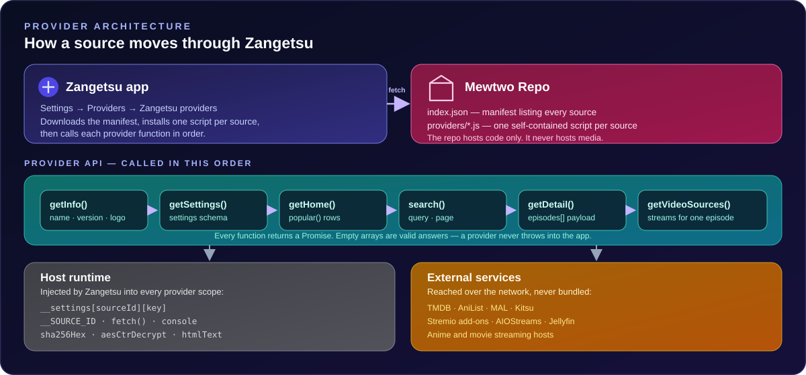

# Architecture

How Mewtwo Repo is put together, how the app loads a source, and where to change things.

<p align="center">
  
</p>

---

## The shape of the thing

Mewtwo Repo has no build, no bundler, no package manager and no runtime dependencies. It is a **manifest** plus a **folder of self-contained JavaScript files**.

```text
Mewtwo-repo/
├── index.json          The manifest. One entry per source.
├── providers/          One self-contained .js file per source.
├── tests/              One test file per source, plus a shared health suite.
├── scripts/            Validation, test runner and documentation generator.
├── assets/             SVGs used by the README and the documentation.
├── docs/               This documentation.
└── .github/            CI workflow, issue and pull-request templates.
```

That simplicity is deliberate. The app downloads a manifest, downloads the individual provider files it needs, and evaluates them. Nothing is compiled, so a source can be updated by editing one file and bumping one version number.

---

## The manifest

`index.json` is the only thing the app needs in order to show the repository.

```json
{
  "name": "𝑴𝒆𝒘𝒕𝒘𝒐♡ Repo",
  "description": "𝑴𝒆𝒘𝒕𝒘𝒐♡ community sources for Zangetsu. Third-party provider integrations; this repository does not host video files.",
  "sources": [
    {
      "id": "tmdb-pencari",
      "name": "TMDB + PencariMovie",
      "version": "1.0.0",
      "type": "movie",
      "lang": "en",
      "file": "providers/tmdb-pencari.js",
      "logo": "https://www.google.com/s2/favicons?sz=256&domain=pencarimovie.com",
      "nsfw": false,
      "settings": [ /* mirrors the provider's getSettings() */ ]
    }
  ]
}
```

### Source fields

| Field | Required | Meaning |
|:--|:--:|:--|
| `id` | yes | Stable identifier. Also the runtime key for the provider's settings slot |
| `name` | yes | Display name. Must match `getInfo().name` exactly |
| `version` | yes | Must match `getInfo().version` and `module.exports.version`. Bump it on every change |
| `type` | yes | `anime` or `movie`. Must match `getInfo().type`. Used to group sources in the picker |
| `lang` | yes | Language code: `en`, `hi`, `es`, `all`, … |
| `file` | yes | Path to the provider script, relative to the manifest. Must live inside `providers/` |
| `logo` | yes | Square icon URL |
| `nsfw` | no | Marks the source as 18+ so the app can gate it behind the privacy toggle |
| `settings` | no | A mirror of the provider's `getSettings()`. The app builds the settings UI from the provider itself; this copy exists so the manifest and the code can be checked against each other |

### Setting descriptors

| Type | Default | Options | Notes |
|:--|:--|:--|:--|
| `text` | `""` | — | Free-form string |
| `bool` | `true` / `false` | — | Must be a JSON boolean, not the string `"true"` |
| `enum` | one option `value` | `[{ value, label }]` | The default must match an option value, otherwise the first option wins |
| `multiEnum` | array of option values | `[{ value, label }]` | The default is an array of strings, each matching an option value |

---

## Provider registration

There is no registry file. Registration is the manifest itself:

1. The app fetches `index.json`.
2. It reads `sources[]` and resolves each `file` relative to the manifest URL, so a provider can live anywhere under the same repository.
3. The user taps **Install** on a source, and the app downloads that provider file and evaluates it.
4. The provider's `getInfo()` result is compared against the manifest entry. `scripts/check-and-run.mjs` enforces the same rule in CI.

**Consequence:** adding a source means adding a file to `providers/` **and** an entry to `index.json`. The CI check fails if a `providers/*.js` file is not registered, and it also fails if a manifest entry points at a file that does not exist.

---

## The provider contract

Every provider exports the same set of functions. The names, the arguments and the returned shapes are fixed by the app, not by this repository.

| Function | Called with | Returns |
|:--|:--|:--|
| `getInfo()` | — | `{ name, lang, baseUrl, logo, type, version }` |
| `getSettings()` | — | Array of setting descriptors (the schema behind the settings form) |
| `getHome(opts)` | `{ category }` | `[{ title, items: [MediaItem] }]` — one row per shelf |
| `popular(opts)` | `{ category, dateRange, page }` | `[MediaItem]` |
| `search(query, page, opts)` | `query`, `page`, `{ category }` | `[MediaItem]` |
| `getDetail(url, opts)` | the item's `url`, `{ category }` | A `MediaDetail`, including its `episodes` array |
| `getEpisodes(url, opts)` | the item's `url`, `{ category }` | `[Episode]` |
| `getVideoSources(episodeUrl, opts)` | the episode's `url` | `[VideoSource]` |

`getHome` and `popular` are optional in the app: a provider without `getHome` still gets home rows synthesised from `popular`.

> `getStreams` and `getLinks` also exist in this repository, but they are **aliases of `getVideoSources`**, not part of the app's API. They exist so the repository's own validation script can check every provider uniformly. Do not expect the app to call them.

### `getInfo()`

```js
function getInfo() {
  return {
    name: 'TMDB + PencariMovie',
    lang: 'en',
    baseUrl: 'https://www.themoviedb.org',
    logo: 'https://www.google.com/s2/favicons?sz=256&domain=pencarimovie.com',
    type: 'movie',
    version: '1.0.0'
  };
}
```

`baseUrl` is the site the provider is built around. It is not fetched by the app — it identifies the source.

---

## The host runtime

The app evaluates each provider inside a scope that injects a small set of helpers.

### Injected into the provider's scope

| Global | Type | Purpose |
|:--|:--|:--|
| `__SOURCE_ID` | string | The manifest `id` of the source being run |
| `__settings` | object | `{ [sourceId]: { [settingKey]: value } }` |
| `fetch(url, opts)` | function | The app's HTTP client |
| `console` | object | Routed into the app's log |

### Available on the global object

| Global | Purpose |
|:--|:--|
| `htmlText(html)` | Strips tags and decodes entities |
| `absUrl(href, base)` | Resolves a relative URL against a base |
| `unpackJs(source)` | Unpacks a JavaScript packer payload |
| `sha256Hex(message)` | SHA-256, as a Promise |
| `aesCtrDecrypt({ keyHex, counterHex, dataB64 })` | AES-CTR, as a Promise |
| `base64ToBytes(b64)`, `bytesToHex(bytes)`, `bytesToB64(bytes)` | Byte helpers |

Providers that need their own AES implementation (CineStream, the Serenity providers) implement it in pure JavaScript rather than depending on the host, so they work identically under the repository's own test runner.

### The `fetch` contract

This is **not** the browser `fetch`. The differences matter:

| | Browser `fetch` | The app's `fetch` |
|:--|:--|:--|
| `response.body` | a `ReadableStream` | a **string** |
| `response.headers` | a `Headers` object | a **plain object** — use `headers['content-type']`, not `headers.get()` |
| Timeout | `signal` / `AbortController` | **`timeoutMs`** |
| Redirects | `redirect: 'follow' \| 'manual'` | **`followRedirects: boolean`** |
| Cloudflare | — | `browser: true` or `cf: true` opts into the native solver |
| Response | `ok`, `status`, `statusText`, `url`, `json()`, `text()` | the same, plus `body` |

```js
fetch(url, { headers: { Accept: 'application/json' }, timeoutMs: 12000 })
  .then(function (response) {
    if (response.status >= 400) throw new Error('HTTP ' + response.status);
    var body = response.body != null ? response.body : '';
    return typeof body === 'string' ? JSON.parse(body || 'null') : body;
  });
```

The host caps any request at 25 seconds, so `timeoutMs` above that is clamped rather than honoured.

---

## The catalogue flow

```text
search(query, page, opts)
        │
        ├──► a metadata backend (TMDB, AniList, or the site's own API)
        │
        └──► [MediaItem] ──► the app stores { id, title, cover, banner, url, type, score, … }
                                    │
                                    ▼
                             getDetail(url, opts)
                                    │
                                    ├──► a metadata backend
                                    │
                                    └──► MediaDetail { title, description, genres, year,
                                                       episodes: [Episode], tmdbId, imdbId, … }
```

### Item identity

The `id` and `url` of a catalogue item are **opaque strings that the app round-trips unchanged**. The app never parses them. Each provider picks a scheme that suits it and re-parses the same string later:

| Scheme | Used by | Example |
|:--|:--|:--|
| `tmdb://movie/<id>` | TMDB-backed sources | `tmdb://movie/27205` |
| `miruro://anime/<id>` | Miruro | `miruro://anime/178005` |
| `anilist://<id>` | Zenkai Player | `anilist://21` |
| `jellyfin://item/<id>?…` | Jellyfin | `jellyfin://item/abc123?type=Series` |

### Item shape

```js
{
  id: 'tmdb://movie/27205',
  title: 'Inception (2010)',
  cover: 'https://image.tmdb.org/t/p/w500/…jpg',
  banner: 'https://image.tmdb.org/t/p/w780/…jpg',
  url: 'tmdb://movie/27205',
  type: 'movie',            // per-title: 'anime' | 'movie' | 'manga' | 'novel'
  sourceId: 'tmdb-pencari',
  score: 78,                // 0–100
  year: '2010',
  tmdbId: 27205,
  tmdbIsTv: false,          // true distinguishes a series from a movie
  imdbId: 'tt1375666',
  genres: ['Action', 'Science Fiction']
}
```

`sourceId` is overwritten by the app with the registry's own id, so it is informational rather than load-bearing.

### Episode shape

```js
{
  id: '1x1',
  title: 'S01 E01 - Pilot',
  number: 1,
  url: '<opaque payload>',   // this is what getVideoSources() receives
  date: '2010-07-15',
  thumbnail: 'https://image.tmdb.org/t/p/w300/…jpg'
}
```

The `url` carries whatever the provider needs to resolve playback later. Three styles are in use in this repository:

| Style | Example | Used by |
|:--|:--|:--|
| JSON string | `JSON.stringify({ tmdbId, season, episode, … })` | TMDB-backed sources, Zenkai Player, CineStream |
| URI-encoded JSON in a custom scheme | `miruro://episode/<encodeURIComponent(json)>` | Miruro |
| Custom scheme with a query | `animeparadise://episode/<id>?origin=<id>` | AnimeParadise |

---

## The playback flow

```text
getVideoSources(episodeUrl, opts)
        │
        ├──► parse the episode payload back into identifiers
        │
        ├──► one or more upstream hosts, usually in parallel
        │      ├── an add-on manifest  (PencariMovie, Stremio, AIOStreams)
        │      ├── a media server      (Jellyfin PlaybackInfo)
        │      ├── the site's own API  (AniChan, AnimeOnsen, Miruro)
        │      └── an embed player     (MegaPlay, VidWish, HubCloud, VOE, …)
        │
        └──► [VideoSource]
```

### Stream shape

```js
{
  url: 'https://…/master.m3u8',
  quality: '1080p',          // or 'Auto'
  label: 'MegaPlay · 1080p',
  container: 'hls',          // 'hls' | 'mp4' | 'torrent'
  kind: 'raw',               // 'sub' | 'dub' | 'raw'
  headers: { Referer: 'https://…' }
}
```

Two values in this object are recognised by the app's player: `container` understands `hls`, `mp4` and `torrent`, and `kind` understands `sub`, `dub` and `raw`. Anything else falls back to `unknown` and the player sniffs the URL instead.

Request headers matter. Many hosts refuse a request without the right `Referer` or `Origin`, so a provider that resolves a URL but drops the headers will produce a stream that fails the moment it is played.

### Where playback gets hard

| Problem | How providers handle it |
|:--|:--|
| The real media sits behind an embed page | The provider walks the site's own chain — list endpoint, server list, embed — and extracts the final URL |
| The payload is encrypted | The provider decrypts it in pure JavaScript (AES-256-CBC for MegaPlay and VidWish, AES-GCM for AniChan) |
| A signed URL expires | Signed URLs are re-resolved every time rather than cached. Stream URLs are deliberately never cached |
| Many hosts, one slow one | Providers run hosts concurrently, isolate failures, and share a total time budget. CineStream uses an 18-second budget; the app allows roughly 20 seconds |
| A dead host empties the list | Providers list a stream per working host, so one dead host costs you one stream rather than all of them |

---

## Settings handling

The app builds the settings form from `getSettings()`, stores the user's values per repository and per source, and injects them before every call:

```js
__settings = { tmdb-pencari: { tmdbApiKey: '', maxStreamsPerAddon: '25' } }
```

Reading a value in a provider:

```js
var SOURCE_ID = (typeof __SOURCE_ID !== 'undefined' && __SOURCE_ID) ? String(__SOURCE_ID) : 'my-source';

function _readSetting(key) {
  try {
    var settings = typeof __settings !== 'undefined' && __settings ? __settings[SOURCE_ID] : null;
    return settings && settings[key] != null ? settings[key] : null;
  } catch (e) { return null; }
}
```

Values arrive **already coerced to the schema's type**: a `bool` is a real boolean, an `enum` is a string, a `multiEnum` is an array of strings. The defensive string checks you will see in this repository (`value === true || String(value).toLowerCase() === 'true'`) are for safety, not necessity.

The most robust pattern — used by the Serenity providers — re-derives the coercion from the schema itself, so a value that is not valid for its type falls back to the declared default instead of propagating:

```js
function setting(key) {
  var schema = getSettings().filter(function (s) { return s.key === key; })[0];
  if (!schema) return undefined;
  var saved = (typeof __settings === 'object' && __settings[SOURCE_ID]) || {};
  var value = saved[key];
  if (schema.type === 'bool') return typeof value === 'boolean' ? value : schema.default;
  if (schema.type === 'enum') return schema.options.some(function (o) { return o.value === value; }) ? value : schema.default;
  if (schema.type === 'multiEnum') return Array.isArray(value) ? value : schema.default.slice();
  return typeof value === 'string' ? value : schema.default;
}
```

---

## Dependencies

**None.** No `package.json`, no `node_modules`, no lockfile.

The test and validation tooling uses only the Node.js standard library: `node:fs`, `node:path`, `node:child_process`, `node:vm`, `node:module`. `scripts/check-and-run.mjs` runs on Node 22 with no install step.

Runtime dependencies of the *providers* are the remote services they talk to — TMDB, AniList, the streaming hosts, and so on. Those are not vendored and not bundled; they are called over the network at runtime.

---

## Build and packaging

There is no build step. The "build" is:

1. Write `providers/<name>.js`.
2. Add the matching entry to `index.json`.
3. Bump the version in both `getInfo()` and the manifest.
4. Run `node scripts/check-and-run.mjs`.
5. Open a pull request.

`index.json` is served straight from the `main` branch over `raw.githubusercontent.com`, so **merging to `main` is the release**. There is no tag, no build matrix and no artefact to publish.

The documentation has one generated file, `docs/EXTENSIONS.md`. It is produced by `scripts/generate-extensions-doc.mjs` from `index.json` and `docs/source-notes.json`, and CI verifies that the committed copy still matches.

---

## Where to make changes

| I want to… | Change this |
|:--|:--|
| Add a source | `providers/<new>.js` **and** an entry in `index.json` |
| Fix a broken host in a source | `providers/<name>.js`, then bump its version in the file and the manifest |
| Change a source's settings | `getSettings()` in the provider **and** the `settings` array in `index.json` — the two must agree on keys and order |
| Change how a source is described | `docs/source-notes.json`, then run `node scripts/generate-extensions-doc.mjs` |
| Change the setup guidance | `docs/SOURCE_CONFIGURATION.md` |
| Change the documentation index | `docs/README.md` |
| Add a source to the test suite | `tests/<name>.test.js` |
| Change the shared validation rules | `scripts/check-and-run.mjs` |
| Change the CI workflow | `.github/workflows/test.yml` |

---

## Testing model

`tests/` contains one test file per source plus a shared `provider-health.test.js`. The health suite loads every provider, exercises every public method against mocked and controlled-fixture responses, and asserts that:

- every method settles rather than throwing when the upstream fails,
- every method returns an array when it fulfils,
- every attempted fetch targets an absolute HTTPS URL,
- no cleartext HTTP URL literal appears in the source.

Live network checks are opt-in and off by default, so CI is deterministic. They are enabled with a `PROVIDER_HEALTH_CASES` environment variable pointing at a JSON map of source id to a method and arguments.

Run the whole thing with:

```bash
node scripts/check-and-run.mjs
```

---

## Related documentation

- [Development guide](DEVELOPMENT.md) — tooling, conventions and the local loop
- [Source catalogue](EXTENSIONS.md) — every source
- [Source configuration](SOURCE_CONFIGURATION.md) — every setting
- [Contributing](../CONTRIBUTING.md)

---

<p align="center">
  <a href="README.md">Documentation index</a> &nbsp;·&nbsp;
  <a href="#architecture">Back to top ↑</a>
</p>
