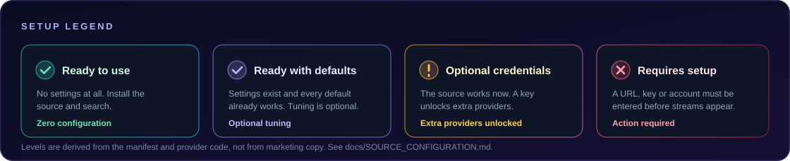

<!--
  AUTO-GENERATED FILE — do not edit by hand.
  Source of truth: index.json (identity, version, type, language, settings)
                    docs/source-notes.json (purpose, behaviour, limitations)
  Regenerate: node scripts/generate-extensions-doc.mjs
  Verify:     node scripts/generate-extensions-doc.mjs --check
-->

# Source catalogue

Every source published by this repository, with the exact version in the manifest and the setup it actually needs. Setup levels are derived from the provider code — see [SOURCE_CONFIGURATION.md](SOURCE_CONFIGURATION.md) for the step-by-step configuration walkthroughs.

| | Count | Sources |
|:--|--:|:--|
| 🟢 Ready to use | 13 | No settings, no credentials. |
| 🔵 Ready with defaults | 8 | Settings exist and every default works. |
| 🟡 Optional credentials | 2 | Works as installed; a key unlocks extra hosts. |
| 🟠 Requires configuration | 2 | A URL or add-on list must be entered. |
| 🔴 Requires an account or server | 1 | Needs your own server and login. |
| **Total** | **26** | 19 anime · 7 movie and TV |

---

## Index

| Source | Type | Lang | Version | Setup | Purpose |
|:--|:--|:--:|:--|:--|:--|
| [Jellyfin](#jellyfin) | movie | en | `3.1.0` | 🔴 Requires an account or server | Read a Jellyfin — or AIOStreams media server — library as a native catalogue and play the media versions that server exposes. |
| [AIOStreams](#aiostreams) | movie | en | `2.2.0` | 🟠 Requires configuration | Browse and search through TMDB, then resolve playback through the add-ons configured in your own AIOStreams instance. |
| [TMDB + Stremio](#tmdb--stremio) | movie | en | `3.3.0` | 🟠 Requires configuration | Use TMDB as the catalogue and any Stremio-compatible add-on you configure as the playback provider. |
| [TMDB + PencariMovie](#tmdb--pencarimovie) | movie | en | `1.0.0` | 🔵 Ready with defaults | The simplest way to get started: TMDB supplies the catalogue, a PencariMovie server supplies the streams. |
| [AnimeSuge](#animesuge) | anime | en | `1.0.3` | 🟢 Ready to use | AnimeSuge catalogue with its own player extraction, listing every working server for an episode. |
| [AniKoto](#anikoto) | anime | en | `1.2.4` | 🟢 Ready to use | AniKoto catalogue with a two-step server chain and a fallback mapper for extra servers. |
| [AnimeSalt](#animesalt) | anime | hi | `1.0.3` | 🟢 Ready to use | AnimeSalt catalogue with multi-server listing and local AES decryption. |
| [DesiDub Anime](#desidub-anime) | anime | hi | `1.0.1` | 🟢 Ready to use | Hindi, Tamil and Telugu dubbed catalogue served by a WordPress JSON API. |
| [AnimeParadise](#animeparadise) | anime | en | `1.0.1` | 🟢 Ready to use | Its own catalogue and REST API, with short-lived episode stream tokens. |
| [AnV](#anv) | anime | en | `1.0.4` | 🟢 Ready to use | AnV catalogue with a self-minted session cookie and freshly signed stream URLs. |
| [HiAnime](#hianime) | anime | en | `1.2.2` | 🟢 Ready to use | HiAnime catalogue with MegaPlay and Zoko extraction. |
| [Miruro](#miruro) | anime | en | `1.0.1` | 🔵 Ready with defaults | Multi-server anime catalogue with per-episode server fallback. |
| [AniChan](#anichan) | anime | en | `1.0.1` | 🟢 Ready to use | AniList discovery with AniChan's own watch API and encrypted HLS playback. |
| [HDHub4u](#hdhub4u) | movie | hi | `1.2.4` | 🟢 Ready to use | Hindi movies and shows with TMDB enrichment and several link-hub resolvers. |
| [AnimeKai (Unoriginal)](#animekai-unoriginal) | anime | en | `0.2.9` | 🔵 Ready with defaults | AnimeKai catalogue with a pure-JavaScript MegaPlay decoder. |
| [AniWave (Unoriginal)](#aniwave-unoriginal) | anime | en | `0.2.9` | 🔵 Ready with defaults | AniWave catalogue with the same pure-JavaScript MegaPlay decoder. |
| [MegaPlay](#megaplay) | anime | en | `1.0.3` | 🟢 Ready to use | MegaPlay playback for the AniKoto catalogue. |
| [MMani](#mmani) | anime | en | `1.0.2` | 🟢 Ready to use | MMani catalogue with HLS playback and subtitle tracks. |
| [AniZone](#anizone) | anime | en | `1.0.3` | 🟢 Ready to use | AniZone catalogue with HLS playback and subtitle tracks. |
| [RareAnimes](#rareanimes) | anime | hi | `1.0.5` | 🟢 Ready to use | RareAnimes catalogue with multi-language playback. |
| [Mewstream](#mewstream) | movie | en | `4.0.5` | 🟡 Optional credentials | One source that queries sixteen anime and movie hosts at the same time. |
| [Zenkai Player](#zenkai-player) | anime | en | `1.4.1` | 🔵 Ready with defaults | AniList metadata with native MegaPlay, VidStream and ACDN multi-audio playback. |
| [AnimeOnsen](#animeonsen) | anime | all | `1.0.1` | 🔵 Ready with defaults | AnimeOnsen catalogue with DASH playback and ASS subtitle tracks. |
| [AnimeGG](#animegg) | anime | en | `1.0.2` | 🔵 Ready with defaults | AnimeGG catalogue that returns a direct progressive MP4. |
| [AnimeAV1](#animeav1) | anime | es | `1.0.1` | 🔵 Ready with defaults | AnimeAV1 catalogue in Spanish with VOE and YourUpload playback. |
| [CineStream](#cinestream) | movie | en | `1.0.9` | 🟡 Optional credentials | An aggregate movie and TV source covering 58 HTTP providers plus Wyzie Subs. |

---

## Movie and TV sources (7)

### Jellyfin

`id: jellyfin` · `v3.1.0` · movie · en · not flagged NSFW

| Field | Value |
|:--|:--|
| **Purpose** | Read a Jellyfin — or AIOStreams media server — library as a native catalogue and play the media versions that server exposes. |
| **Metadata** | The Jellyfin server itself (libraries, seasons, episodes, artwork, subtitle tracks). No TMDB involved. |
| **Setup** | 🔴 Requires an account or server — Needs a reachable server address plus either a username and password or an API key. |
| **Settings** | 9 exposed |

**Credentials and settings**

- serverUrl — full server URL including any base path
- username + password — normal Jellyfin login
- apiKey — optional alternative to password login (userId only if the server cannot resolve a user from the key)

| Setting | Type | Default | Choices |
|:--|:--|:--|:--|
| Server address (`serverUrl`) | text | _(empty)_ | — |
| Username (`username`) | text | _(empty)_ | — |
| Password (`password`) | text | _(empty)_ | — |
| API key (optional) (`apiKey`) | text | _(empty)_ | — |
| User ID (API key only) (`userId`) | text | _(empty)_ | — |
| Library ID (optional) (`libraryId`) | text | _(empty)_ | — |
| Catalogue page size (`pageSize`) | enum | `50` | 25, 50, 100 |
| Maximum streaming bitrate (`maxStreamingBitrate`) | enum | `40000000` | 16 Mbps, 25 Mbps, 40 Mbps, 80 Mbps, Device maximum |
| Include external subtitles (`includeSubtitles`) | bool | `true` | — |

**Behaviour**

Authenticates with POST /Users/AuthenticateByName or an X-Emby-Token API key. Catalogue and episode-list requests deliberately omit MediaSources, so stream add-ons are only resolved when playback versions are requested. Playback is negotiated through POST /Items/{itemId}/PlaybackInfo; the version's required request headers are preserved and never forwarded to an unrelated external host. A library that advertises a mandatory genre is resolved automatically.

**Limitations**

- The JavaScript provider interface exposes no playback start, stop or progress callbacks, so Continue Watching and Next Up are read from the server but playback progress is never reported back.
- Generic source settings render text fields without masking, so a password or API key is visible while editing. Use a dedicated account with only the permissions you need, prefer HTTPS outside a trusted LAN, and never share screenshots that contain credentials.

### AIOStreams

`id: aiostreams` · `v2.2.0` · movie · en · not flagged NSFW

| Field | Value |
|:--|:--|
| **Purpose** | Browse and search through TMDB, then resolve playback through the add-ons configured in your own AIOStreams instance. |
| **Metadata** | TMDB for the catalogue; your AIOStreams instance for streams. |
| **Setup** | 🟠 Requires configuration — The personalised manifest URL is the one value you must supply. |
| **Settings** | 8 exposed |

**Credentials and settings**

- manifestUrl — required, ends in /stremio/<id>/<config>/manifest.json
- userDataBase64 — optional x-aiostreams-user-data value; takes precedence over Basic authentication
- tmdbApiKey — optional personal v3 API key or Read Access Token; blank uses the key the app injects

| Setting | Type | Default | Choices |
|:--|:--|:--|:--|
| AIOStreams Manifest URL (required) (`manifestUrl`) | text | _(empty)_ | — |
| Optional AIOStreams UserData (base64) (`userDataBase64`) | text | _(empty)_ | — |
| TMDB API key or Read Access Token (optional) (`tmdbApiKey`) | text | _(empty)_ | — |
| Show torrent / P2P streams (`showP2P`) | bool | `false` | — |
| Maximum concurrent requests (`maxConcurrentRequests`) | enum | `5` | 2 requests, 3 requests, 4 requests, 5 requests |
| TMDB request timeout (`requestTimeoutMs`) | enum | `5000` | 3 seconds, 5 seconds, 7 seconds, 10 seconds |
| AIOStreams request timeout (`streamTimeoutMs`) | enum | `9000` | 4 seconds, 5 seconds, 7 seconds, 9 seconds |
| Total stream lookup deadline (`totalTimeoutMs`) | enum | `12000` | 5 seconds, 8 seconds, 10 seconds, 12 seconds |

**Behaviour**

Stream lookups are rejected with an explicit error when the manifest URL is empty. The instance's embedded credentials are sent as HTTP Basic authentication, or as the UserData header when one is supplied. When TMDB returns no streams for an anime episode the source maps the title through AIOStreams' own anime database and retries with MAL, AniList, Kitsu, AniDB, IMDb or TVDB identifiers. A priority queue keeps playback lookups ahead of queued metadata requests under a hard total deadline.

**Limitations**

- Installing this source does not import any Stremio add-on. The add-ons live in your own AIOStreams instance.
- Your manifest URL and UserData value are private. Treat them as credentials and never publish them.

### TMDB + Stremio

`id: tmdb-stremio` · `v3.3.0` · movie · en · not flagged NSFW

| Field | Value |
|:--|:--|
| **Purpose** | Use TMDB as the catalogue and any Stremio-compatible add-on you configure as the playback provider. |
| **Metadata** | TMDB, with optional catalogue and metadata add-ons. |
| **Setup** | 🟠 Requires configuration — At least one streaming add-on manifest URL is needed before the source can return streams. |
| **Settings** | 6 exposed |

**Credentials and settings**

- addonUrls — required, one or more add-on manifest URLs
- metadataAddonUrls — optional separate catalogue and metadata add-ons
- tmdbApiKey — optional personal v3 API key; blank uses the key the app injects

| Setting | Type | Default | Choices |
|:--|:--|:--|:--|
| TMDB API Key (optional; blank uses app default) (`tmdbApiKey`) | text | _(empty)_ | — |
| Streaming Add-on URLs (manifest URLs; comma/newline separated) (`addonUrls`) | text | _(empty)_ | — |
| Metadata Add-on URLs (manifest URLs; comma/newline separated) (`metadataAddonUrls`) | text | _(empty)_ | — |
| Use metadata add-on catalogues (`enableAddonCatalogs`) | bool | `false` | — |
| Show torrent / P2P streams (`showP2P`) | bool | `false` | — |
| Max streams per add-on (limit results from each add-on) (`maxStreamsPerAddon`) | enum | `25` | 5 streams, 10 streams, 25 streams, 50 streams, 100 streams |

**Behaviour**

Every configured streaming add-on is queried independently, so one failing add-on does not stop the others. Catalogue and metadata responses are cached and can be served stale during a transient network failure. Anime lookups use only identifiers that are actually present in the metadata — no anime-ID mapping is invented.

**Limitations**

- A catalogue entry can appear even when no configured add-on has a matching stream.
- Torrent and magnet results are hidden unless Show torrent / P2P streams is enabled and the player understands magnet links.
- A personal TMDB key is routed through a trailing-dot hostname so the app's own key interceptor cannot replace it.

### TMDB + PencariMovie

`id: tmdb-pencari` · `v1.0.0` · movie · en · not flagged NSFW

| Field | Value |
|:--|:--|
| **Purpose** | The simplest way to get started: TMDB supplies the catalogue, a PencariMovie server supplies the streams. |
| **Metadata** | TMDB for titles, artwork and episode lists. |
| **Setup** | 🔵 Ready with defaults — The public PencariMovie manifest URL is prefilled, so nothing has to be entered. |
| **Settings** | 3 exposed |

| Setting | Type | Default | Choices |
|:--|:--|:--|:--|
| TMDB API Key (optional; blank uses app default) (`tmdbApiKey`) | text | _(empty)_ | — |
| PencariMovie server manifest URL (`pencariMovieServerUrl`) | text | `https://stream.pencarimovie.com/66ff097863dedb7ccd8401d5ffe616f3/ma…` | — |
| Max streams per add-on (limit results from each add-on) (`maxStreamsPerAddon`) | enum | `25` | 5 streams, 10 streams, 25 streams, 50 streams, 100 streams |

**Behaviour**

Streams are requested from the add-on's /stream/{type}/{id}.json route and de-duplicated by URL. A custom tokenised /manifest.json URL can replace the default if you run your own server.

**Limitations**

- A title appearing in TMDB does not guarantee that PencariMovie has a playable stream for it.

### HDHub4u

`id: hdhub4u` · `v1.2.4` · movie · hi · not flagged NSFW

| Field | Value |
|:--|:--|
| **Purpose** | Hindi movies and shows with TMDB enrichment and several link-hub resolvers. |
| **Metadata** | HDHub4u's own Typesense-backed search, enriched with TMDB titles and artwork. |
| **Setup** | 🟢 Ready to use — No settings and no credentials. |
| **Settings** | none |

**Behaviour**

The live domain is refreshed from a published domain list and a cached domain is used only when that list cannot be reached. Stream links are followed through several link-hub hops and decrypted locally where the host requires it. Direct links carry the real quality and release name from the upstream filename.

**Limitations**

- The live domain changes frequently, so a source that worked yesterday may need the domain list to refresh.

### Mewstream

`id: mewstream` · `v4.0.5` · movie · en · not flagged NSFW

| Field | Value |
|:--|:--|
| **Purpose** | One source that queries sixteen anime and movie hosts at the same time. |
| **Metadata** | TMDB for the catalogue, enriched with Kitsu and other public anime databases. |
| **Setup** | 🟡 Optional credentials — Works as installed. Only Showbox needs a credential, and only to enable that one host. |
| **Settings** | 17 exposed |

**Credentials and settings**

- showboxToken — optional Showbox / Febbox ui cookie value; without it the Showbox host is skipped
- tmdbApiKey — optional personal v3 API key; blank uses the key the app injects

| Setting | Type | Default | Choices |
|:--|:--|:--|:--|
| TMDB API key (optional) (`tmdbApiKey`) | text | _(empty)_ | — |
| Showbox (Febbox) UI token (`showboxToken`) | text | _(empty)_ | — |
| MegaPlay (MAL/AniList direct) (`enableMegaplayDirect`) | bool | `true` | — |
| AniKoto (`enableAnikoto`) | bool | `true` | — |
| AniZone (`enableAnizone`) | bool | `true` | — |
| AnimeSalt (`enableAnimesalt`) | bool | `true` | — |
| RareAnimes (`enableRareanimes`) | bool | `true` | — |
| Showbox (`enableShowbox`) | bool | `true` | — |
| VaPlayer (`enableVaplayer`) | bool | `true` | — |
| Vidrock (`enableVidrock`) | bool | `true` | — |
| Vidzee (`enableVidzee`) | bool | `true` | — |
| Vidfast (`enableVidfast`) | bool | `true` | — |
| Hexa (`enableHexa`) | bool | `true` | — |
| VidSrc (`enableVidsrc`) | bool | `true` | — |
| VidCore / VidUp (`enableVidcore`) | bool | `true` | — |
| moviesapi.to (`enableMoviesapi`) | bool | `true` | — |
| VidNest (`enableVidnest`) | bool | `true` | — |

**Behaviour**

Sixteen adapters run concurrently and every real HTTP result is kept, so one dead host does not empty the list. Each adapter can be switched off individually. Showbox is skipped unless both an IMDb ID and a token are present. Diagnostics distinguish a host you disabled from a host that was tried and produced nothing.

**Limitations**

- Showbox is the only host in this source that needs a credential.
- Host domains change often, so individual adapters can stop working without a code change.

### CineStream

`id: cinestream` · `v1.0.9` · movie · en · not flagged NSFW

| Field | Value |
|:--|:--|
| **Purpose** | An aggregate movie and TV source covering 58 HTTP providers plus Wyzie Subs. |
| **Metadata** | TMDB, with AniList and other public anime databases used for id mapping. |
| **Setup** | 🟡 Optional credentials — The source works as installed. Each credential unlocks one specific host. |
| **Licence** | GPL-3.0 — see [Licensing](README.md#licensing) |
| **Settings** | 11 exposed |

**Credentials and settings**

- showboxToken — required by the Showbox provider only
- wyzieSubsKey — required by the Wyzie Subtitles provider only; a free key is available from sub.wyzie.io
- gramcinemaToken — required by the GramCinema provider only
- movieblastToken, movieblastApi, movieblastKey — build-time values in the upstream project; MovieBlast stays dormant until they are supplied
- castleKey — build-time value in the upstream project; Castle stays dormant until it is supplied
- tmdbApiKey — optional personal v3 API key; blank uses the key the app injects

| Setting | Type | Default | Choices |
|:--|:--|:--|:--|
| Enabled providers (`enabledProviders`) | multiEnum | `59 selected` | Showbox, Vidrock, Moviebox, MovieBlast, Fibwatch, Allmovieland, Hdhub4u, Hexa, Fshare, Videasy, VaPlayer, Vidzee, Peachify, VidFastPro, Cinejoy, Vidcore, Av1encodes, Castle, Reanime, Just4Anime, Zinkmovies, Gramcinema, VegaMovies, RogMovies, Bollyflix, TopMovies, Vidup, Meowtv, Moviesmod, Movies4u, Dudefilms, UHDMovies, MoviesDrive, Hindmoviez, 4KHDHub, PrimeSrc, ProjectFreeTV, Mlsbd, Levidia, Animesalt, M4ufree, Multimovies, Akwam, Rtally, Asiaflix, SkyMovies, KissKH, Onetouchtv, Toonstream, Anineko, Animedao, Anikoto, Anikage, Anidb, AnimeToshoHttp, TokyoInsider, Anizone, Animekizz, Wyzie Subs |
| Showbox / Febbox UI token (`showboxToken`) | text | _(empty)_ | — |
| Wyzie Subs API key (`wyzieSubsKey`) | text | _(empty)_ | — |
| GramCinema bearer token (`gramcinemaToken`) | text | _(empty)_ | — |
| TMDB API key (optional) (`tmdbApiKey`) | text | _(empty)_ | — |
| MovieBlast token (`movieblastToken`) | text | _(empty)_ | — |
| MovieBlast API base (`movieblastApi`) | text | _(empty)_ | — |
| MovieBlast signing key (`movieblastKey`) | text | _(empty)_ | — |
| Castle APK sign key (`castleKey`) | text | _(empty)_ | — |
| Provider concurrency (`concurrency`) | enum | `10` | 4, 6, 8, 10 (default), 14 |
| Include download-only links (`includeDownloadLinks`) | bool | `false` | — |

**Behaviour**

All enabled providers run concurrently under a hard 18 second playback budget, and each provider is isolated so one failure does not affect the others. Providers are gated by title: anime-only hosts run for anime, Bollywood-only hosts for Bollywood titles, and unrestricted hosts always run. Metadata, search and home responses are cached with a TTL and duplicate requests are de-duplicated, but stream URLs are never cached because they are short-lived and signer-bound.

**Limitations**

- MovieBlast and Castle need build-time credentials that are not part of this repository, so they produce no streams until you supply them.
- Stremio add-on discovery, Torrentio, TorrentsDB, AnimeTosho-torrent and StremioSubs are intentionally not part of this port.
- Many upstream hosts change domain frequently. Hosts refresh from the upstream url list when it is reachable, with public defaults embedded as a fallback.
- Real-player playback could not be verified in the porting environment. HTTP-level extraction is covered by tests; in-app playback should be confirmed on a real device.

---

## Anime sources (19)

### AnimeSuge

`id: animesuge` · `v1.0.3` · anime · en · not flagged NSFW

| Field | Value |
|:--|:--|
| **Purpose** | AnimeSuge catalogue with its own player extraction, listing every working server for an episode. |
| **Metadata** | AnimeSuge's own catalogue. |
| **Setup** | 🟢 Ready to use — No settings and no credentials. |
| **Settings** | none |

**Behaviour**

Derives the site's VRF token locally and decrypts MegaPlay and VidWish payloads with AES-256-CBC in pure JavaScript. A stream is listed per working server, so one dead server no longer empties the whole list.

### AniKoto

`id: anikoto` · `v1.2.4` · anime · en · not flagged NSFW

| Field | Value |
|:--|:--|
| **Purpose** | AniKoto catalogue with a two-step server chain and a fallback mapper for extra servers. |
| **Metadata** | AniKoto's own catalogue. |
| **Setup** | 🟢 Ready to use — No settings and no credentials. |
| **Settings** | none |

**Behaviour**

Resolves the episode's encrypted server list, walks the site's own server chain and extracts a plain m3u8 plus subtitle tracks from the embed host. When an episode's own servers produce nothing playable, a mapper service is asked for additional servers. This provider is written in the original script-global form the app evaluates directly.

**Limitations**

- Some episodes list only servers that no longer return a plain file. Those episodes may have no stream at all.

### AnimeSalt

`id: animesalt` · `v1.0.3` · anime · hi · not flagged NSFW

| Field | Value |
|:--|:--|
| **Purpose** | AnimeSalt catalogue with multi-server listing and local AES decryption. |
| **Metadata** | AnimeSalt's own catalogue. |
| **Setup** | 🟢 Ready to use — No settings and no credentials. |
| **Settings** | none |

**Behaviour**

Uses the same VRF and AES-256-CBC scheme as AnimeSuge, and tags each stream with the server it came from.

### DesiDub Anime

`id: desidubanime` · `v1.0.1` · anime · hi · not flagged NSFW

| Field | Value |
|:--|:--|
| **Purpose** | Hindi, Tamil and Telugu dubbed catalogue served by a WordPress JSON API. |
| **Metadata** | The site's own WordPress API. |
| **Setup** | 🟢 Ready to use — No settings and no credentials. |
| **Settings** | none |

**Behaviour**

Home rows are filtered by language tag. Playback resolves through the statically extractable server only.

**Limitations**

- Only the VidMoly server ships. The remaining servers need a real browser to mint their token, so they are skipped.

### AnimeParadise

`id: animeparadise` · `v1.0.1` · anime · en · not flagged NSFW

| Field | Value |
|:--|:--|
| **Purpose** | Its own catalogue and REST API, with short-lived episode stream tokens. |
| **Metadata** | AnimeParadise's own API. |
| **Setup** | 🟢 Ready to use — No settings and no credentials. |
| **Settings** | none |

**Behaviour**

Episode stream tokens are short-lived and are resolved at play time rather than cached; a 30 second episode cache avoids resolving the same episode twice.

### AnV

`id: anv` · `v1.0.4` · anime · en · not flagged NSFW

| Field | Value |
|:--|:--|
| **Purpose** | AnV catalogue with a self-minted session cookie and freshly signed stream URLs. |
| **Metadata** | AnV's own catalogue. |
| **Setup** | 🟢 Ready to use — No settings and no credentials — the session cookie is obtained at runtime. |
| **Settings** | none |

**Behaviour**

Loads the episode watch page to capture the session cookie the site sets for itself. Signed /stream/ URLs are always resolved fresh instead of being reused, because they are short-lived.

**Limitations**

- One server prepends a fake PNG header to every segment, which players reject. It is skipped whenever a clean server is available.
- Catalogue objects are shaped like AniList records but use the site's own id space, so an AniList id does not address the same title here.

### HiAnime

`id: hianime` · `v1.2.2` · anime · en · not flagged NSFW

| Field | Value |
|:--|:--|
| **Purpose** | HiAnime catalogue with MegaPlay and Zoko extraction. |
| **Metadata** | HiAnime's own catalogue; Kitsu is used for episode thumbnails only. |
| **Setup** | 🟢 Ready to use — No settings and no credentials. |
| **Settings** | none |

**Behaviour**

Tries the listed player servers in turn and falls back to the Zoko route when MegaPlay cannot be decrypted.

**Limitations**

- MegaPlay now encrypts both of its source endpoints, so the Zoko route carries the playback.
- Roughly a quarter of episodes list no playable server at all.

### Miruro

`id: miruro` · `v1.0.1` · anime · en · not flagged NSFW

| Field | Value |
|:--|:--|
| **Purpose** | Multi-server anime catalogue with per-episode server fallback. |
| **Metadata** | Miruro's own JSON API, mirrored across three hosts. |
| **Setup** | 🔵 Ready with defaults — Three API mirrors and the full server order are prefilled. Every setting can be overridden. |
| **Settings** | 11 exposed |

| Setting | Type | Default | Choices |
|:--|:--|:--|:--|
| API mirror URLs (comma or newline separated) (`apiHosts`) | text | `https://api.hiyori.tv
https://miruro.zenos.my.id
https://www.neoani…` | — |
| Streaming server priority (`providerOrder`) | text | `bee,bonk,hop,kiwi,pewe,ally,nun,bun,twin,cog,moo,sun,knob,telli` | — |
| Disabled streaming servers (`disabledProviders`) | text | _(empty)_ | — |
| Audio tracks (`audioMode`) | enum | `both` | Sub and dub, Sub only, Dub only |
| Automatic server fallback (`autoFallback`) | bool | `true` | — |
| Maximum server attempts per episode (`maxProviderAttempts`) | enum | `8` | 3 servers, 5 servers, 8 servers, All servers (14 max) |
| API request timeout (`requestTimeoutMs`) | enum | `8000` | 8 seconds, 15 seconds, 25 seconds |
| Preferred video quality (`qualityPreference`) | enum | `auto` | Automatic, 1080p, 720p, 480p, 360p |
| Home sections (comma separated) (`homeSections`) | text | `spotlight,trending,recent,popular` | — |
| Show adult catalogue entries (`showAdult`) | bool | `false` | — |
| Metadata and episode cache (`cacheSeconds`) | enum | `120` | Disabled, 1 minute, 2 minutes, 5 minutes |

**Behaviour**

Rotates through the configured API hosts when one is blocked, times out, is rate limited or returns invalid JSON. During playback it tries the watch endpoint, then the quality-aware stream endpoint, then the detailed sources endpoint, and finally moves on to the next available server for the same episode. Episodes are grouped by number, so several servers can serve one episode without creating duplicate rows.

**Limitations**

- Miruro and its API hosts are independently operated services. Fallback improves resilience but cannot guarantee a playable link for every title.

### AniChan

`id: anichan` · `v1.0.1` · anime · en · not flagged NSFW

| Field | Value |
|:--|:--|
| **Purpose** | AniList discovery with AniChan's own watch API and encrypted HLS playback. |
| **Metadata** | AniList's public GraphQL API for discovery; AniChan for episodes and servers. |
| **Setup** | 🟢 Ready to use — No settings and no credentials. |
| **Settings** | none |

**Behaviour**

Resolves titles through AniList, then asks AniChan for the episode count, dub flag and available servers. Playback uses a short-lived session cookie minted by POST /api/watch/session. Encrypted replies are decrypted locally and the keyset is re-read when the site rotates it. Server requests are tiered, trying the fast tier before the rest tier. MegaPlay and VidHawk results are filtered out because other sources here already cover them.

**Limitations**

- AniChan publishes a null Cloudflare Turnstile site key. The provider sends an empty token and never solves or bypasses a CAPTCHA — if the site enables Turnstile, session creation fails with an explicit error.
- The watch session is short-lived and may need refreshing between requests.
- AniList search can return titles AniChan does not carry. Those fail at detail time so the picker can move on.

### AnimeKai (Unoriginal)

`id: serenity-animekai` · `v0.2.9` · anime · en · not flagged NSFW

| Field | Value |
|:--|:--|
| **Purpose** | AnimeKai catalogue with a pure-JavaScript MegaPlay decoder. |
| **Metadata** | AnimeKai's own catalogue. |
| **Setup** | 🔵 Ready with defaults — All five settings ship with working defaults. |
| **Licence** | Apache-2.0 — see [Licensing](README.md#licensing) |
| **Settings** | 5 exposed |

| Setting | Type | Default | Choices |
|:--|:--|:--|:--|
| Audio language override (`audioLanguage`) | enum | `auto` | Detect automatically, English, Japanese, Chinese, Korean, Hindi, Spanish, French, German, Portuguese, Russian, Arabic |
| Request timeout (`timeout`) | enum | `12000` | 8 seconds, 12 seconds |
| Episode audio (`audio`) | enum | `both` | Sub and dub, Sub only, Dub only |
| Include subtitle tracks (`subtitles`) | bool | `true` | — |
| Home section order (`homeOrder`) | enum | `popular` | Popular, Latest updates |

**Behaviour**

Decodes the MegaPlay payload with AES-256-CBC in pure JavaScript, so no browser, Node runtime or cookie is needed. Audio language, track selection, subtitle inclusion, timeout and home section order are all tunable.

**Limitations**

- The newer getSourcesNew endpoint needs a byte-rewriting proxy and is deliberately not advertised.

### AniWave (Unoriginal)

`id: serenity-aniwave` · `v0.2.9` · anime · en · not flagged NSFW

| Field | Value |
|:--|:--|
| **Purpose** | AniWave catalogue with the same pure-JavaScript MegaPlay decoder. |
| **Metadata** | AniWave's own catalogue. |
| **Setup** | 🔵 Ready with defaults — All five settings ship with working defaults. |
| **Licence** | Apache-2.0 — see [Licensing](README.md#licensing) |
| **Settings** | 5 exposed |

| Setting | Type | Default | Choices |
|:--|:--|:--|:--|
| Audio language override (`audioLanguage`) | enum | `auto` | Detect automatically, English, Japanese, Chinese, Korean, Hindi, Spanish, French, German, Portuguese, Russian, Arabic |
| Request timeout (`timeout`) | enum | `12000` | 8 seconds, 12 seconds |
| Episode audio (`audio`) | enum | `both` | Sub and dub, Sub only, Dub only |
| Include subtitle tracks (`subtitles`) | bool | `true` | — |
| Home section order (`homeOrder`) | enum | `popular` | Popular, Latest updates |

**Behaviour**

Byte-for-byte the same extraction logic as the AnimeKai provider, pointed at a different site.

**Limitations**

- The newer getSourcesNew endpoint needs a byte-rewriting proxy and is deliberately not advertised.

### MegaPlay

`id: megaplay` · `v1.0.3` · anime · en · not flagged NSFW

| Field | Value |
|:--|:--|
| **Purpose** | MegaPlay playback for the AniKoto catalogue. |
| **Metadata** | AniKoto's catalogue, played through MegaPlay. |
| **Setup** | 🟢 Ready to use — No settings and no credentials. |
| **Settings** | none |

**Behaviour**

Walks the server list in order until one resolves, then decrypts the source locally.

**Limitations**

- Titles that AniKoto does not list are not searchable here.
- Server list and site URLs are shared with the AniKoto provider, so they change together.

### MMani

`id: mmani` · `v1.0.2` · anime · en · not flagged NSFW

| Field | Value |
|:--|:--|
| **Purpose** | MMani catalogue with HLS playback and subtitle tracks. |
| **Metadata** | MMani's own catalogue. |
| **Setup** | 🟢 Ready to use — No settings and no credentials. |
| **Settings** | none |

**Behaviour**

Resolves the episode's servers and then reads the player configuration for the HLS playlist and its subtitle tracks. Streams are ordered by ascending quality because the app auto-plays the last entry in the list.

### AniZone

`id: anizone` · `v1.0.3` · anime · en · not flagged NSFW

| Field | Value |
|:--|:--|
| **Purpose** | AniZone catalogue with HLS playback and subtitle tracks. |
| **Metadata** | AniZone's own catalogue. |
| **Setup** | 🟢 Ready to use — No settings and no credentials. |
| **Settings** | none |

**Behaviour**

The catalogue is parsed from an inline JSON payload embedded in the page. Playback is returned with the Referer and Origin headers the host expects.

### RareAnimes

`id: rareanimes-streambeta` · `v1.0.5` · anime · hi · not flagged NSFW

| Field | Value |
|:--|:--|
| **Purpose** | RareAnimes catalogue with multi-language playback. |
| **Metadata** | RareAnimes' own catalogue. |
| **Setup** | 🟢 Ready to use — No settings and no credentials. |
| **Settings** | none |

**Behaviour**

Tries five player-extraction methods in turn and every link of a variant, so one dead link does not hide a working one. It follows meta-refresh, iframe and data-attribute wrappers.

**Limitations**

- Playback is served through wrapper pages that change often.
- Hindi, Tamil and Telugu dubs appear only when the upstream page lists them.

### Zenkai Player

`id: zenkaii` · `v1.4.1` · anime · en · not flagged NSFW

| Field | Value |
|:--|:--|
| **Purpose** | AniList metadata with native MegaPlay, VidStream and ACDN multi-audio playback. |
| **Metadata** | AniList for discovery, with AniMap mapping AniList ids to MAL ids. |
| **Setup** | 🔵 Ready with defaults — The server and audio preference both ship with defaults. |
| **Settings** | 2 exposed |

| Setting | Type | Default | Choices |
|:--|:--|:--|:--|
| Zenkai Player server (`server`) | enum | `megaplay` | MegaPlay (HD-1), VidStream (HD-2), FlixCloud (fallback), ACDN (Multi-audio) |
| Preferred audio (`audio`) | enum | `sub` | SUB · Original audio, DUB · English audio |

**Behaviour**

ACDN returns a single multi-audio HLS playlist rather than a normal sub or dub file; the signed CDN playlist is offered first with the upstream proxy kept as a fallback. AniList is rate limited, so requests are spaced out and retried after a cooldown.

**Limitations**

- FlixCloud falls back to the supported direct MegaPlay and VidStream resolvers until a public direct resolver is available.
- Long-running episode totals fall back to MAL and the raw AniList next-airing record when AniList does not have them.

### AnimeOnsen

`id: animeonsen` · `v1.0.1` · anime · all · not flagged NSFW

| Field | Value |
|:--|:--|
| **Purpose** | AnimeOnsen catalogue with DASH playback and ASS subtitle tracks. |
| **Metadata** | AnimeOnsen's own API. |
| **Setup** | 🔵 Ready with defaults — The public AnimeOnsen client credentials are built into the provider and the access token is refreshed automatically — there is nothing for you to configure. |
| **Settings** | 3 exposed |

| Setting | Type | Default | Choices |
|:--|:--|:--|:--|
| Request timeout (`requestTimeoutMs`) | enum | `12000` | 6 seconds, 12 seconds, 18 seconds |
| Home catalogue size (`homeLimit`) | enum | `30` | 15 titles, 30 titles, 50 titles |
| Include external subtitles (`includeSubtitles`) | bool | `true` | — |

**Behaviour**

Resolves DASH manifests with multiple quality representations and attaches the site's ASS subtitle tracks. The search token is read from the page's own meta tag.

**Limitations**

- Playback quality is limited to the representations the host publishes.

### AnimeGG

`id: animegg` · `v1.0.2` · anime · en · not flagged NSFW

| Field | Value |
|:--|:--|
| **Purpose** | AnimeGG catalogue that returns a direct progressive MP4. |
| **Metadata** | AnimeGG's own catalogue. |
| **Setup** | 🔵 Ready with defaults — Both settings ship with defaults. |
| **Settings** | 2 exposed |

| Setting | Type | Default | Choices |
|:--|:--|:--|:--|
| Audio tracks (`audioMode`) | enum | `both` | Sub and dub, Sub only, Dub only |
| Request timeout (`requestTimeoutMs`) | enum | `12000` | 6 seconds, 12 seconds, 18 seconds |

**Behaviour**

Returns the direct progressive MP4 file rather than an iframe, and attaches the Referer header the host requires.

### AnimeAV1

`id: animeav1` · `v1.0.1` · anime · es · not flagged NSFW

| Field | Value |
|:--|:--|
| **Purpose** | AnimeAV1 catalogue in Spanish with VOE and YourUpload playback. |
| **Metadata** | AnimeAV1's own catalogue. |
| **Setup** | 🔵 Ready with defaults — Both settings ship with defaults. |
| **Settings** | 2 exposed |

| Setting | Type | Default | Choices |
|:--|:--|:--|:--|
| Audio tracks (`audioMode`) | enum | `both` | Sub and dub, Sub only, Dub only |
| Request timeout (`requestTimeoutMs`) | enum | `12000` | 6 seconds, 12 seconds, 18 seconds |

**Behaviour**

Resolves VOE HLS and YourUpload MP4 embeds down to real media URLs. When only a subtitled version is listed, the dub track falls back to it.

**Limitations**

- The catalogue is Spanish-language only.

---

## Settings reference

Every setting key exposed by any source, for quick lookup.

| Key | Source | Type | Default |
|:--|:--|:--|:--|
| `serverUrl` | Jellyfin | text | _(empty)_ |
| `username` | Jellyfin | text | _(empty)_ |
| `password` | Jellyfin | text | _(empty)_ |
| `apiKey` | Jellyfin | text | _(empty)_ |
| `userId` | Jellyfin | text | _(empty)_ |
| `libraryId` | Jellyfin | text | _(empty)_ |
| `pageSize` | Jellyfin | enum | `50` |
| `maxStreamingBitrate` | Jellyfin | enum | `40000000` |
| `includeSubtitles` | Jellyfin | bool | `true` |
| `manifestUrl` | AIOStreams | text | _(empty)_ |
| `userDataBase64` | AIOStreams | text | _(empty)_ |
| `tmdbApiKey` | AIOStreams | text | _(empty)_ |
| `showP2P` | AIOStreams | bool | `false` |
| `maxConcurrentRequests` | AIOStreams | enum | `5` |
| `requestTimeoutMs` | AIOStreams | enum | `5000` |
| `streamTimeoutMs` | AIOStreams | enum | `9000` |
| `totalTimeoutMs` | AIOStreams | enum | `12000` |
| `tmdbApiKey` | TMDB + Stremio | text | _(empty)_ |
| `addonUrls` | TMDB + Stremio | text | _(empty)_ |
| `metadataAddonUrls` | TMDB + Stremio | text | _(empty)_ |
| `enableAddonCatalogs` | TMDB + Stremio | bool | `false` |
| `showP2P` | TMDB + Stremio | bool | `false` |
| `maxStreamsPerAddon` | TMDB + Stremio | enum | `25` |
| `tmdbApiKey` | TMDB + PencariMovie | text | _(empty)_ |
| `pencariMovieServerUrl` | TMDB + PencariMovie | text | `https://stream.pencarimovie.com/66ff097863dedb7ccd8401d5ffe616f3/ma…` |
| `maxStreamsPerAddon` | TMDB + PencariMovie | enum | `25` |
| `apiHosts` | Miruro | text | `https://api.hiyori.tv
https://miruro.zenos.my.id
https://www.neoani…` |
| `providerOrder` | Miruro | text | `bee,bonk,hop,kiwi,pewe,ally,nun,bun,twin,cog,moo,sun,knob,telli` |
| `disabledProviders` | Miruro | text | _(empty)_ |
| `audioMode` | Miruro | enum | `both` |
| `autoFallback` | Miruro | bool | `true` |
| `maxProviderAttempts` | Miruro | enum | `8` |
| `requestTimeoutMs` | Miruro | enum | `8000` |
| `qualityPreference` | Miruro | enum | `auto` |
| `homeSections` | Miruro | text | `spotlight,trending,recent,popular` |
| `showAdult` | Miruro | bool | `false` |
| `cacheSeconds` | Miruro | enum | `120` |
| `audioLanguage` | AnimeKai (Unoriginal) | enum | `auto` |
| `timeout` | AnimeKai (Unoriginal) | enum | `12000` |
| `audio` | AnimeKai (Unoriginal) | enum | `both` |
| `subtitles` | AnimeKai (Unoriginal) | bool | `true` |
| `homeOrder` | AnimeKai (Unoriginal) | enum | `popular` |
| `audioLanguage` | AniWave (Unoriginal) | enum | `auto` |
| `timeout` | AniWave (Unoriginal) | enum | `12000` |
| `audio` | AniWave (Unoriginal) | enum | `both` |
| `subtitles` | AniWave (Unoriginal) | bool | `true` |
| `homeOrder` | AniWave (Unoriginal) | enum | `popular` |
| `tmdbApiKey` | Mewstream | text | _(empty)_ |
| `showboxToken` | Mewstream | text | _(empty)_ |
| `enableMegaplayDirect` | Mewstream | bool | `true` |
| `enableAnikoto` | Mewstream | bool | `true` |
| `enableAnizone` | Mewstream | bool | `true` |
| `enableAnimesalt` | Mewstream | bool | `true` |
| `enableRareanimes` | Mewstream | bool | `true` |
| `enableShowbox` | Mewstream | bool | `true` |
| `enableVaplayer` | Mewstream | bool | `true` |
| `enableVidrock` | Mewstream | bool | `true` |
| `enableVidzee` | Mewstream | bool | `true` |
| `enableVidfast` | Mewstream | bool | `true` |
| `enableHexa` | Mewstream | bool | `true` |
| `enableVidsrc` | Mewstream | bool | `true` |
| `enableVidcore` | Mewstream | bool | `true` |
| `enableMoviesapi` | Mewstream | bool | `true` |
| `enableVidnest` | Mewstream | bool | `true` |
| `server` | Zenkai Player | enum | `megaplay` |
| `audio` | Zenkai Player | enum | `sub` |
| `requestTimeoutMs` | AnimeOnsen | enum | `12000` |
| `homeLimit` | AnimeOnsen | enum | `30` |
| `includeSubtitles` | AnimeOnsen | bool | `true` |
| `audioMode` | AnimeGG | enum | `both` |
| `requestTimeoutMs` | AnimeGG | enum | `12000` |
| `audioMode` | AnimeAV1 | enum | `both` |
| `requestTimeoutMs` | AnimeAV1 | enum | `12000` |
| `enabledProviders` | CineStream | multiEnum | `59 selected` |
| `showboxToken` | CineStream | text | _(empty)_ |
| `wyzieSubsKey` | CineStream | text | _(empty)_ |
| `gramcinemaToken` | CineStream | text | _(empty)_ |
| `tmdbApiKey` | CineStream | text | _(empty)_ |
| `movieblastToken` | CineStream | text | _(empty)_ |
| `movieblastApi` | CineStream | text | _(empty)_ |
| `movieblastKey` | CineStream | text | _(empty)_ |
| `castleKey` | CineStream | text | _(empty)_ |
| `concurrency` | CineStream | enum | `10` |
| `includeDownloadLinks` | CineStream | bool | `false` |

---

## Related documentation

- [Source configuration](SOURCE_CONFIGURATION.md) — step-by-step setup for every configurable source
- [Installation](INSTALLATION.md) — adding the repository and installing sources
- [Getting started](GETTING_STARTED.md) — from install to first playback
- [Architecture](ARCHITECTURE.md) — how providers are loaded and executed

Generated from `index.json` and `docs/source-notes.json`. Run `node scripts/generate-extensions-doc.mjs` to refresh.
