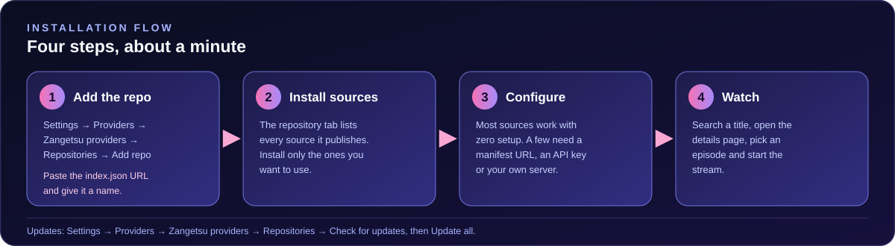

# Installation guide

Everything needed to get Mewtwo Repo running inside Zangetsu, from nothing to a working source.

---

## Before you start

### Prerequisites

| Requirement | Notes |
|:--|:--|
| **Zangetsu** | The app these sources belong to. Get the APK from the [releases page](https://github.com/Spyou/Zangetsu/releases/latest). Verified against **v2.3.5**. |
| **A network connection** | Every source is a live client of a remote service. Nothing is cached offline. |
| **Your own account, for three sources** | AIOStreams needs your personalised manifest URL, TMDB + Stremio needs your add-on URLs, and Jellyfin needs your server and login. Mewstream and CineStream also accept optional keys. See the [configuration guide](SOURCE_CONFIGURATION.md). |
| **Nothing else** | There is no build step, no clone, no toolchain and no app modification. You add a URL and the app does the rest. |

### Supported platforms

| Platform | Build | These sources |
|:--|:--|:--|
| Android phone & tablet | `Zangetsu-v*-arm64-v8a.apk` | Supported |
| Android (32-bit devices) | `Zangetsu-v*-armeabi-v7a.apk` | Supported |
| Android TV | `Zangetsu-v*-tv.apk` | Supported |
| iOS / iPadOS (beta) | `Zangetsu-v*-ios.ipa` | Supported |
| Windows | — | Not yet |

Pick `arm64-v8a` if you are unsure whether you have a 64-bit device; pick `universal` if you want one APK for everything.

> [!NOTE]
> These are Zangetsu's **own JavaScript sources**. They are not CloudStream, Aniyomi or Mihon extensions, which is why they work on iOS as well.

### Where the repository URL comes from

The manifest is a single static file at the root of this repository. Copy it from the block below — it is the same URL used by every guide in this documentation.

```text
https://raw.githubusercontent.com/MewtwoOP1/Mewtwo-repo/main/index.json
```

<details>
<summary>Why the URL has to end in <code>index.json</code></summary>

The app has two different add-mechanisms and they are easy to confuse:

- **Add a repository** — you give it the *manifest*. The manifest lists every source in this repo, and you then choose which ones to install.
- **Install a single provider** — you give it the *provider file*. That installs one source and nothing else.

`index.json` is the manifest. A `providers/*.js` URL is a single provider. If you paste a provider URL into the *Add repo* dialog, the app will not find a source list.

</details>

---

## Step 1 — Add the repository

The exact menu path depends on your Zangetsu build. Both are listed below; the first is current.

**Current builds**

1. Open **Settings**.
2. Tap **Providers** (the *Sources* section of Settings).
3. Tap **Zangetsu providers**.
4. Switch to the **Repositories** tab.
5. Tap **Add repo**.

**Older builds**

1. Open **Settings → Sources**.
2. Tap **Add repo**.

In both cases the app shows an **Add repo** dialog with a **Manifest URL** field (the placeholder is `https://.../index.json`), an optional **Custom name** field, and the hint *"Paste the repo's index.json URL — the JSON file that lists every source in the repo, not a single provider .js URL."*

1. Paste the manifest URL into **Manifest URL**.
2. Optionally set a **Custom name**. Leave it blank to use the repository's own name, which is *𝑴𝒆𝒘𝒕𝒘𝒐♡ Repo*.
3. Save.

The repository now appears in the **Repositories** tab with every source it publishes.

<p align="center">
  
</p>

---

## Step 2 — Install individual sources

You do **not** have to install all 26 sources. Each one is independent: installing a source never installs another, and removing one never affects the others.

1. Stay in the **Repositories** tab and find the repository you just added.
2. The list under it shows every source with its name, type and version.
3. Tap **Install** next to the sources you want.

Once installed, a source moves to the **Installed** tab, where it becomes selectable as your active source.

### Which sources to install

| If you want… | Install |
|:--|:--|
| The quickest possible start with movies and series | **TMDB + PencariMovie** — a public server URL is already filled in |
| Anime, subbed and dubbed, with a fallback server per episode | **Miruro** — three API mirrors and fourteen servers are prefilled |
| Anime with AniList metadata and multi-audio | **Zenkai Player** |
| A wide catalogue of anime sites at once | **Mewstream** — sixteen hosts queried in parallel |
| The broadest movie and series coverage | **CineStream** — 59 providers, each independently switchable |
| Your own Stremio add-ons | **TMDB + Stremio** — you supply the add-on URLs |
| Your own AIOStreams instance | **AIOStreams** — you supply the manifest URL |
| Your own Jellyfin library | **Jellyfin** — you supply the server address and login |

The [source catalogue](EXTENSIONS.md) lists all 26 with their purpose, language, version and limitations.

---

## Step 3 — Configure what asks for it

Most sources expose no settings at all. When a source does have settings, they appear under the source's own entry — open **Installed → your source → Source settings**.

| Source | Does it need configuration? |
|:--|:--|
| **Jellyfin** | **Yes** — server address plus a login, or an API key |
| **AIOStreams** | **Yes** — your personalised `/stremio/<id>/<config>/manifest.json` URL |
| **TMDB + Stremio** | **Yes** — at least one add-on manifest URL |
| **TMDB + PencariMovie** | No — the public server URL is prefilled |
| **Miruro, Zenkai Player, AnimeOnsen, AnimeGG, AnimeAV1, AnimeKai, AniWave** | No — every default works |
| **Mewstream, CineStream** | No — but each optional key unlocks one more host |
| **AnimeSuge, AniKoto, AnimeSalt, DesiDub Anime, AnimeParadise, AnV, HiAnime, AniChan, HDHub4u, MegaPlay, MMani, AniZone, RareAnimes** | No — these expose no settings whatsoever |

Each source's settings, in full, are documented in the [configuration guide](SOURCE_CONFIGURATION.md).

---

## Step 4 — Verify the installation

Work through these in order. The first one that fails tells you where the problem is.

### 4.1 The repository appears

Open **Settings → Providers → Zangetsu providers → Repositories**. The repository is listed with its own name and a source count.

- **Not listed?** The manifest was probably not saved, or the URL was truncated. See [the repository does not appear](#the-repository-does-not-appear).

### 4.2 The source list loads

Open the repository and confirm that the sources are listed with names, types and versions. If the list is empty but the repository is present, the manifest was fetched but could not be parsed — re-add it with the exact `index.json` URL.

### 4.3 The source installs

Tap **Install**. The source appears in the **Installed** tab and can be selected as the active source.

### 4.4 The catalogue responds

With the source selected, open **Search** and look for a title you know the site carries. A result list means the source reached its catalogue backend successfully.

### 4.5 The playback path responds

Open the title, select an episode, and look at the source list.

- **Streams appear** — you are done. Tap one to play.
- **Titles load but no streams appear** — the catalogue half works and the playback half does not. This is the single most common state, and it is almost always a configuration or upstream problem. Go to [Troubleshooting](TROUBLESHOOTING.md#titles-load-but-no-streams-appear).
- **Nothing appears at all** — the source could not reach its backend. Go to [Troubleshooting](TROUBLESHOOTING.md#the-source-returns-nothing-at-all).

### 4.6 Use the built-in health check

Zangetsu has its own diagnostic: **Settings → Providers → Source health** — *"Test which sources are working."* Run it before opening an issue. It tells you which installed sources answered and which did not, which narrows a report down enormously.

---

## Step 5 — Updating sources

The app re-reads the manifest and compares versions, so an update is a version bump in `index.json`.

1. Open **Settings → Providers → Zangetsu providers → Repositories**.
2. Tap **Check for updates**.
3. Sources with a newer version show an **Update** action, and the repository shows **Update all (N)**.

Android builds can also be told to update installed sources automatically at launch: **Settings → Providers → Source updates → Auto-update extensions**.

> [!TIP]
> Settings are stored per repository and per source, so updating a source never wipes the values you entered. Clearing the app's storage does.

---

## Common installation problems

### The repository does not appear

**Cause.** The most common reasons, in order:

1. **The URL was truncated or edited.** It must be exactly `https://raw.githubusercontent.com/MewtwoOP1/Mewtwo-repo/main/index.json`.
2. **A provider file URL was pasted instead of the manifest.** A `providers/*.js` URL is one source, not a repository.
3. **The device has no network access to `raw.githubusercontent.com`.** Some networks and DNS configurations block it. Test the URL in the device's browser first.
4. **The app was never given network permission**, or a restrictive battery manager blocked the background fetch.

**What to try.**

- Long-press the URL in this page and copy it directly rather than typing it.
- Open the manifest URL on the same device and confirm it returns JSON rather than an error page.
- Remove the repository and add it again from the copy button.
- Check the app's permission settings for network access.

### The repository appears but lists no sources

**Cause.** The manifest was fetched but produced no parseable source list — almost always a truncated URL that still resolved to something.

**What to try.** Re-add the repository using the exact URL, and confirm that [the raw manifest](https://raw.githubusercontent.com/MewtwoOP1/Mewtwo-repo/main/index.json) shows a JSON object with a `sources` array when opened in a browser.

### Install fails or the source never appears in Installed

**Cause.** The provider file could not be downloaded or parsed.

**What to try.**

- Confirm the repository listed the source at all. If it is missing from the list, it is not published by this repository.
- Check that the device can open the provider's file URL directly.
- Remove the repository, re-add it, and try again — a failed first attempt is sometimes cached.
- Look for an error in the app's log for that source.

### A source works but shows no results for a specific title

**Cause.** Usually upstream. The title is not in that source's catalogue, the upstream site has changed its markup, or the upstream site blocked the request.

**What to try.**

- Search for the title in a different source to confirm the title exists at all.
- Open the source's own website on the same device and search for the title there. If the website itself cannot find it, the source is faithfully reporting an upstream reality.
- Run **Source health** to check whether the source answers for other titles.

### Playback fails after it starts

**Cause.** Usually a dead CDN segment, an expired signed URL, or a host that requires headers the player did not send.

**What to try.**

- Go back and pick a different stream. Providers list several, and the first one is frequently the weakest.
- Try the same episode in a different source.
- For Jellyfin, check the server's own logs — see the [Jellyfin section of the configuration guide](SOURCE_CONFIGURATION.md#jellyfin).

### Everything stopped working at once

**Cause.** A network problem, an outage at `raw.githubusercontent.com`, or a device that has lost DNS.

**What to try.** Open the manifest URL on the device's browser. If that fails, the problem is the network, not the repository.

---

## Related documentation

- [Getting started](GETTING_STARTED.md) — from installation to your first episode
- [Source configuration](SOURCE_CONFIGURATION.md) — every setting, in detail
- [Source catalogue](EXTENSIONS.md) — all 26 sources
- [Troubleshooting](TROUBLESHOOTING.md) — symptom-by-symptom fixes
- [FAQ](FAQ.md) — frequently asked questions

---

<p align="center">
  <a href="README.md">Documentation index</a> &nbsp;·&nbsp;
  <a href="#installation-guide">Back to top ↑</a>
</p>
