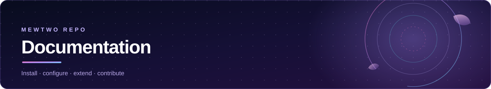

<p align="center">
  
</p>

<p align="center">
  <a href="../README.md">Repository</a> &nbsp;·&nbsp;
  <a href="INSTALLATION.md">Installation</a> &nbsp;·&nbsp;
  <a href="GETTING_STARTED.md">Getting started</a> &nbsp;·&nbsp;
  <a href="EXTENSIONS.md">Sources</a> &nbsp;·&nbsp;
  <a href="SOURCE_CONFIGURATION.md">Configuration</a> &nbsp;·&nbsp;
  <a href="ARCHITECTURE.md">Architecture</a> &nbsp;·&nbsp;
  <a href="DEVELOPMENT.md">Development</a> &nbsp;·&nbsp;
  <a href="TROUBLESHOOTING.md">Troubleshooting</a> &nbsp;·&nbsp;
  <a href="FAQ.md">FAQ</a>
</p>

---

# Documentation

Everything about Mewtwo Repo, written to be read in the order you need it.

| Guide | Read it when | Audience |
|:--|:--|:--|
| **[Installation](INSTALLATION.md)** | You want to add the repository and install sources | Everyone |
| **[Getting started](GETTING_STARTED.md)** | The repository is installed and you want to watch something | New users |
| **[Source catalogue](EXTENSIONS.md)** | You want to know which sources exist and what each one does | Everyone |
| **[Source configuration](SOURCE_CONFIGURATION.md)** | A source asks for a URL, a key or your server details | Users and admins |
| **[Architecture](ARCHITECTURE.md)** | You want to know how the pieces fit together | Contributors |
| **[Development](DEVELOPMENT.md)** | You are about to write or change a provider | Contributors |
| **[Troubleshooting](TROUBLESHOOTING.md)** | Something is not working | Everyone |
| **[FAQ](FAQ.md)** | You have a question that is not a symptom | Everyone |

Repository-level documents live at the root:

| Document | Purpose |
|:--|:--|
| **[README.md](../README.md)** | Project overview and quick start |
| **[CONTRIBUTING.md](../CONTRIBUTING.md)** | How to propose and ship a change |
| **[SECURITY.md](../SECURITY.md)** | How to report a vulnerability |
| **[THIRD_PARTY_NOTICES.md](../THIRD_PARTY_NOTICES.md)** | Attribution for every third-party component |
| **[CHANGELOG.md](../CHANGELOG.md)** | What changed, and when |

---

## The short version

**Mewtwo Repo** publishes 26 JavaScript sources for the [Zangetsu](https://github.com/Spyou/Zangetsu) app. Each source is one self-contained file that the app downloads and runs at runtime. Add one repository URL, then install only the sources you want.

```text
https://raw.githubusercontent.com/MewtwoOP1/Mewtwo-repo/main/index.json
```

Thirteen sources need no configuration at all. Eight ship with working defaults. Two accept an optional key that unlocks extra hosts. Two must be configured before they return streams, and one needs your own server. The full breakdown is in the [source catalogue](EXTENSIONS.md); the step-by-step setup is in the [configuration guide](SOURCE_CONFIGURATION.md).

---

## How the documentation fits together

```text
INSTALLATION.md          Add the repository, install sources, update, verify
        │
        ▼
GETTING_STARTED.md       Search, pick an episode, play, understand the result
        │
        ▼
EXTENSIONS.md            Which source should I install?  (generated from index.json)
        │
        ▼
SOURCE_CONFIGURATION.md  How do I fill in this one source's settings?
        │
        ▼
TROUBLESHOOTING.md       Something still went wrong
        │
        ▼
FAQ.md                   The question that is not a symptom
```

Developers reading in the other direction: **[ARCHITECTURE.md](ARCHITECTURE.md)** explains the runtime, **[DEVELOPMENT.md](DEVELOPMENT.md)** explains the repository layout and the local test loop, and **[CONTRIBUTING.md](../CONTRIBUTING.md)** explains the pull-request flow.

---

## Conventions used here

- **Source** is one published provider. **Repository** is this whole project. The app calls a provider a *provider*; both words mean the same thing.
- Setup levels are **derived from the provider code**, not from descriptions. A source is only called "requires configuration" when the code actually refuses to work without a value.
- Example values are **always placeholders** — `YOUR-TOKEN`, `https://your-host/…`. No real credential, token, cookie or personal URL appears anywhere in this documentation.
- Availability claims are **bounded**. These sources depend on third-party services that change without notice, so the docs describe what the code does rather than promising that a provider will keep working.
- The [source catalogue](EXTENSIONS.md) is **generated** from `index.json` and `docs/source-notes.json`. Everything else is written by hand.

---

## Licensing

Mewtwo Repo is not covered by a single licence.

| Component | Licence | File |
|:--|:--|:--|
| Original code, tests, scripts, documentation | **MIT** | [../LICENSE](../LICENSE) |
| `providers/serenity-animekai.js`, `providers/serenity-aniwave.js` | **Apache-2.0** | [../LICENSE-APACHE-2.0](../LICENSE-APACHE-2.0) |
| `providers/cinestream.js` | **GPL-3.0** | [../LICENSE-CINESTREAM.md](../LICENSE-CINESTREAM.md) |

The Apache-2.0 and GPL-3.0 components keep their own upstream attribution notices, which are preserved rather than consolidated away:

- [../NOTICE-YUZONO-ANIME-EXTENSIONS.md](../NOTICE-YUZONO-ANIME-EXTENSIONS.md)
- [../NOTICE-CINESTREAM.md](../NOTICE-CINESTREAM.md)
- [../THIRD_PARTY_NOTICES.md](../THIRD_PARTY_NOTICES.md) — the full index

---

<p align="center">
  
</p>

<p align="center">
  <a href="../README.md">Back to the repository</a> &nbsp;·&nbsp;
  <a href="#documentation">Back to top ↑</a>
</p>
