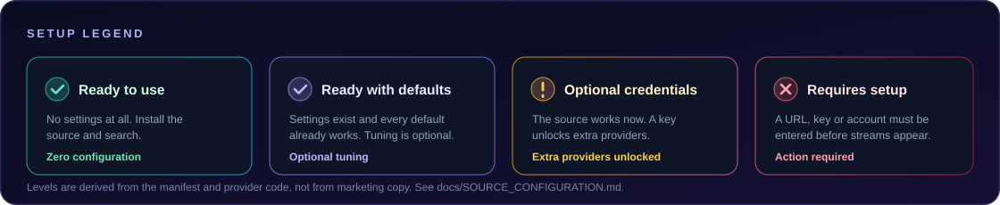

# Source configuration

Which sources need something from you, what exactly to type, where to type it, how to check that it worked, and what to do when it does not.

Every statement on this page is derived from the provider code in `providers/` and the settings schema in `index.json`. A source is only marked as needing setup when the code genuinely cannot work without a value.

---

## At a glance

| Source | Level | What you must supply |
|:--|:--|:--|
| **[Jellyfin](#jellyfin)** | 🔴 Account or server | Server address and a login, or an API key |
| **[AIOStreams](#aiostreams)** | 🟠 Requires configuration | Your personalised `/stremio/<id>/<config>/manifest.json` URL |
| **[TMDB + Stremio](#tmdb--stremio)** | 🟠 Requires configuration | At least one add-on manifest URL |
| **[Mewstream](#mewstream)** | 🟡 Optional credentials | Nothing required; a Showbox token unlocks one host |
| **[CineStream](#cinestream)** | 🟡 Optional credentials | Nothing required; each key unlocks one host |
| **[TMDB + PencariMovie](#tmdb--pencarimovie)** | 🔵 Defaults work | Nothing |
| **[Miruro](#miruro)** | 🔵 Defaults work | Nothing |
| **[Zenkai Player](#zenkai-player)** | 🔵 Defaults work | Nothing |
| **[AnimeOnsen](#animeonsen)** | 🔵 Defaults work | Nothing |
| **[AnimeGG](#animegg)** | 🔵 Defaults work | Nothing |
| **[AnimeAV1](#animeav1)** | 🔵 Defaults work | Nothing |
| **[AnimeKai](#animekai-unoriginal)** | 🔵 Defaults work | Nothing |
| **[AniWave](#aniwave-unoriginal)** | 🔵 Defaults work | Nothing |
| **13 further sources** | 🟢 Ready to use | Nothing at all — they expose no settings |

<p align="center">
  
</p>

---

## Before you type anything

### Where source settings live

**Settings → Providers → Zangetsu providers → Installed → *(your source)* → Source settings.**

Settings are stored per repository **and** per source, so two repositories can publish a source with the same id without overwriting each other's values. Updating a source never clears what you entered. Clearing the app's storage does.

### Treat these values as secrets

Several settings are credentials, not preferences:

| Setting | Why it is sensitive |
|:--|:--|
| AIOStreams **Manifest URL** | Usually embeds your configuration id and password |
| AIOStreams **UserData** | A bearer-equivalent value for your instance |
| Stremio **Add-on URLs** | Often contain a per-user token in the path or query |
| Jellyfin **Password** and **API key** | Direct server credentials |
| Showbox / Febbox **UI token** | A session cookie copied from a logged-in browser session |
| Wyzie Subs **API key** | A personal API key |
| GramCinema **Bearer token** | A personal session token |
| MovieBlast and Castle **keys** | Build-time signing keys |

Never paste any of these into an issue, a pull request, a chat message, a screenshot or a log you share. When you need to show what a setting looks like, show the *label* and redact the *value*.

---

## Jellyfin

**Purpose.** Reads a Jellyfin server — or an AIOStreams media server — as a native catalogue and plays the media versions that server exposes. It does not use TMDB and it does not use the old Stremio-manifest provider.

**Default behaviour.** Nothing works until a server address and a credential are supplied. The source then logs in, discovers the authenticated user's libraries, reads catalogue pages inside each library, loads seasons and episode lists for a series, and negotiates playback through the server's own `PlaybackInfo` route.

**Setup required.** Yes — a reachable server and a way to authenticate.

**Required credentials.**

| Setting | What it is |
|:--|:--|
| **Server address** | The full server URL, including a reverse-proxy path or an AIOStreams `/jellyfin` base path |
| **Username** / **Password** | A normal Jellyfin login. For AIOStreams, use the configuration UUID or alias and the configuration password; append `/UserName` to the username and `/PIN` to the password when that user has a PIN |
| **API key** *(optional)* | An alternative to password login. Send the account's API key |
| **User ID** *(optional)* | Only needed when the server cannot identify a user from the API key on its own |
| **Library ID** *(optional)* | Restricts the source to one library. Leave blank to browse all accessible ones |

**Where to configure.** `Installed → Jellyfin → Source settings → Server address`, `Username`, `Password`.

**Configuration steps.**

1. Make sure the server is reachable from the device running Zangetsu. Use HTTPS for anything outside a trusted LAN.
2. For a normal Jellyfin server, use the address your clients use, including any base path — for example `https://media.example.com/jellyfin`.
3. For an AIOStreams media server, open **Save & Install → Jellyfin apps → Connect** and copy the plain **Server address** that ends in `/jellyfin`. Do **not** paste the Stremio manifest URL.
4. Enter the username and password. For AIOStreams, use the configuration UUID or alias from the same Connect tab and the configuration password.
5. Save, then open the source. It discovers the accessible libraries automatically.

**How to verify.**

- **Libraries appear** in the home and search screens → the address and the login are correct.
- **A 401 or an invalid-login error** → the credentials are wrong. For AIOStreams, re-check the UUID/alias, the password and any PIN.
- **No libraries, but the login succeeded** → the account can authenticate but cannot see any library. Check the account's permissions in the server, and check that the address includes the correct base path.
- **A series opens but shows no episodes** → the server does not expose seasons or episode items for that series. The source does try a fallback episode-list route, so if both are empty the server is the limitation.
- **AIOStreams catalogues are empty** → enable catalogues in the AIOStreams configuration. A library that requires a genre is handled automatically when the server advertises the feature.

**Common errors.**

| Error | Cause | Fix |
|:--|:--|:--|
| `401` / invalid login | Wrong username, password, PIN or UUID | Re-copy the credentials from the Connect tab or the server's user page |
| `404` on every request | Wrong base path in the server address | Include the reverse-proxy or `/jellyfin` path |
| Empty catalogue | The account cannot see the libraries | Grant the account library access |
| Versions exist but playback fails | The stream add-on behind that version cannot resolve the title | Check the relevant add-on inside AIOStreams |

> [!NOTE]
> **Security.** Zangetsu's generic source settings render text fields without password masking, so a password or API key is visible while you are editing it. Use a dedicated account with only the permissions you need, prefer HTTPS outside a trusted LAN, and never share screenshots that contain credentials. AIOStreams documents its API keys as administrator-level access — prefer the normal configuration login when you need the configured user's permissions and watch history.
>
> **Known limitation.** The JavaScript provider interface exposes no playback start, stop or progress callbacks. Continue Watching and Next Up can be read from the server, but this source cannot report playback progress back to Jellyfin.

---

## AIOStreams

**Purpose.** Browses and searches through TMDB, then resolves playback through the add-ons configured in your **own** AIOStreams instance.

**Default behaviour.** The stream lookup is rejected with an explicit error while the manifest URL is empty. Installing this source does **not** import any Stremio add-on — the add-ons live in your AIOStreams instance, not here.

**Setup required.** Yes — the personalised manifest URL.

**Required credentials.**

| Setting | Required | What it is |
|:--|:--:|:--|
| **AIOStreams Manifest URL** | **Yes** | Your personalised URL ending in `/stremio/<id>/<config>/manifest.json` |
| **AIOStreams UserData (base64)** | No | An `x-aiostreams-user-data` value. When present it takes precedence over Basic authentication |
| **TMDB API key or Read Access Token** | No | A personal TMDB v3 key. Leave blank to use the key Zangetsu injects |
| **Show torrent / P2P streams** | No | Off by default. Enable only if your player handles magnet links |
| **Maximum concurrent requests** | No | Defaults to 5 simultaneous requests. This limits concurrency, not the number of links returned |
| **TMDB request timeout** | No | 3 / 5 / 7 / 10 seconds. Defaults to 5 seconds |
| **AIOStreams request timeout** | No | 4 / 5 / 7 / 9 seconds. Defaults to 9 seconds per stream search, including anime-ID fallback attempts |
| **Total stream lookup deadline** | No | 5 / 8 / 10 / 12 seconds. Defaults to 12 seconds across the whole lookup |

**Where to configure.** `Installed → AIOStreams → Source settings → AIOStreams Manifest URL`.

**Configuration steps.**

1. Open your AIOStreams instance and configure the add-ons and stream sources you want.
2. Copy the personalised manifest URL your instance gives you. The general shape is:

   ```text
   https://YOUR-AIOSTREAMS-HOST/stremio/YOUR-ID/YOUR-CONFIG/manifest.json
   ```

   Use the real URL from your instance — the line above is a format example, not a working address.

3. Paste it into **AIOStreams Manifest URL** and save.
4. Only add **UserData** if your instance requires it. When supplied it takes precedence over Basic authentication.
5. Leave **TMDB API key** blank unless you want to use your own.

**How to verify.**

- **Search returns titles** → TMDB is reachable.
- **Titles appear but no streams do** → the manifest URL is wrong, truncated, or points at an instance with no add-ons enabled.
- **An error naming the manifest URL** → it is still empty. The source refuses to look up streams without it.
- **Anime episodes return no streams** → the source maps the title through AIOStreams' own anime database and retries with MAL, AniList, Kitsu, AniDB, IMDb or TVDB identifiers. If the instance has no anime-capable add-on, no amount of waiting will help.

**Common errors.**

| Symptom | Cause | Fix |
|:--|:--|:--|
| `configure the personalized Manifest URL` | The field is empty | Paste the full URL from your instance |
| Timeouts on every lookup | The instance is slow, or an add-on is hanging | Raise **AIOStreams request timeout** and **Total stream lookup deadline**; also raise the per-add-on timeouts inside AIOStreams |
| Nothing but metadata, ever | No stream add-on is enabled in the instance | Enable at least one add-on that provides the `stream` resource |
| Anime has no streams | No anime-capable add-on, or the ID mapping fails | Check the instance's anime database and add-on configuration |

> A client-side timeout cannot make a slow upstream add-on respond faster. If your instance needs more than 12 seconds, the bottleneck is inside the instance.

---

## TMDB + Stremio

**Purpose.** Uses TMDB for search, catalogue browsing, title details and episode lists, and asks the Stremio-compatible add-ons **you** configure for playback.

**Default behaviour.** With no streaming add-on configured, the source returns an empty stream list. The catalogue still works, so titles appear normally with no playable links.

**Setup required.** Yes — at least one add-on manifest URL.

**Required credentials.**

| Setting | Required | What it is |
|:--|:--:|:--|
| **Streaming Add-on URLs** | **Yes** | One or more Stremio-compatible add-on manifest URLs, separated by commas or newlines. Keep each add-on's required path and token intact |
| **Metadata Add-on URLs** | No | Separate add-ons for catalogue rows and title metadata. When blank, the provider falls back to the streaming list |
| **Use metadata add-on catalogues** | No | Off by default. Enable to browse those catalogues and prefer their metadata for those titles |
| **TMDB API Key** | No | A personal TMDB v3 key. Leave blank to use the key Zangetsu injects. Sent only to TMDB |
| **Show torrent / P2P streams** | No | Off by default. Enable only if your player handles magnet links |
| **Max streams per add-on** | No | 5 / 10 / 25 / 50 / 100 streams considered per add-on. Defaults to 25 |

**Where to configure.** `Installed → TMDB + Stremio → Source settings → Streaming Add-on URLs`.

**Configuration steps.**

1. Install **TMDB + Stremio** from this repository, then open **Source settings**.
2. Paste the manifest URL of every add-on that provides playback streams into **Streaming Add-on URLs**. Multiple URLs can be separated by commas or newlines:

   ```text
   https://addon-one.example/manifest.json
   https://addon-two.example/manifest.json
   ```

   These are placeholders — replace them with your own add-on URLs.

3. To use a separate catalogue or metadata add-on, paste its manifest URL into **Metadata Add-on URLs** and enable **Use metadata add-on catalogues**. This is independent of the streaming list; when the metadata list is blank the provider falls back to the streaming list.
4. Leave **TMDB API Key** blank unless you specifically want your own.
5. Save, search for a title, open it and pick a returned stream.

**How to verify.**

- **Titles appear** → TMDB works.
- **Streams appear** → at least one add-on URL is valid and answers.
- **One add-on fails while the others work** → that is expected. Each add-on is queried independently and a failure does not stop the rest.
- **No streams at all** → check that each URL points to a Stremio-compatible add-on that actually provides the `stream` resource. A catalogue-only add-on will load fine and never return a stream.

**Common errors.**

| Symptom | Cause | Fix |
|:--|:--|:--|
| No streams for any title | The add-on list is empty, or the add-ons are catalogue-only | Add an add-on that provides streams |
| Anime titles have no streams | The add-on expects MAL, AniList, Kitsu, IMDb or TVDB identifiers that the metadata does not carry | Use an add-on that supports TMDB ids, or enable a metadata add-on that carries anime ids |
| Magnet links do not appear | Torrent results are hidden by default | Enable **Show torrent / P2P streams** if the player supports magnet links |
| Streams time out | The add-on is slow | Raise **Max streams per add-on** only if too few results are returned; timeouts are the add-on's problem |

---

## TMDB + PencariMovie

**Purpose.** The simplest start in this repository: TMDB supplies the catalogue, a PencariMovie server supplies the streams.

**Default behaviour.** The public PencariMovie manifest URL is prefilled, so the source is usable the moment it is installed. The value is editable if you run your own tokenised `/manifest.json` server.

**Setup required.** No.

**Required credentials.** None. A personal TMDB v3 API key is optional and only used when you supply one.

**Where to configure.** `Installed → TMDB + PencariMovie → Source settings`.

**Configuration steps.** Install it and use it. If you want to point at your own server, replace **PencariMovie server manifest URL** with your own tokenised `/manifest.json` URL.

**How to verify.** Search for a title, open it and look for streams. If the catalogue loads but no streams appear, the public server may be down — this is upstream, and the source itself is configured correctly.

**Common errors.**

| Symptom | Cause | Fix |
|:--|:--|:--|
| Catalogue loads, no streams | The public server has no stream for that title, or is down | Try another title; check the upstream server |
| Nothing at all | The manifest URL was cleared or mistyped | Restore the prefilled default |

---

## Miruro

**Purpose.** A multi-server anime catalogue: search, metadata, episode lists, sub and dub tracks, and playback from the Miruro server pool.

**Default behaviour.** Three API mirrors and the full server order are prefilled, so the source works immediately. Every setting can be overridden.

**Setup required.** No — but the settings are worth understanding.

**Settings.**

| Setting | Default | What it controls |
|:--|:--|:--|
| **API mirror URLs** | Three public JSON API hosts | Ordered, comma- or newline-separated API endpoints. The provider switches to the next host when one is blocked, unavailable, times out or returns invalid JSON |
| **Streaming server priority** | 14 server ids | Comma-separated order. Servers missing from the list are still available, after the listed ones |
| **Disabled streaming servers** | empty | Comma-separated ids to hide and skip |
| **Audio tracks** | Sub and dub | Show both tracks, or filter to one |
| **Automatic server fallback** | On | Try the next server when one returns no playable links or fails |
| **Maximum server attempts per episode** | 8 servers | Limits how many different servers are tried for one episode (3, 5, 8, or all 14) |
| **API request timeout** | 8 seconds | Time for each API host request before rotating to the next host (8, 15 or 25 seconds) |
| **Preferred video quality** | Automatic | 1080p, 720p, 480p or 360p. Other qualities remain available as fallbacks |
| **Home sections** | spotlight, trending, recent, popular | Also `upcoming` is available. Invalid or unavailable sections are skipped |
| **Show adult catalogue entries** | Off | Include results the metadata API marks as adult |
| **Metadata and episode cache** | 2 minutes | Disable it, or use 1, 2 or 5 minutes |

**Where to configure.** `Installed → Miruro → Source settings`.

**Configuration steps.** None are required. Two adjustments are commonly useful:

- **Slow or blocked network** — raise **API request timeout** to 15 or 25 seconds so a slow mirror is not abandoned too early.
- **Too many servers tried per episode** — lower **Maximum server attempts per episode** to 3 or 5 to make playback resolve faster.

**How to verify.** Search for a title, open a series, pick an episode and check that more than one stream appears — Miruro normally offers several, one per working server.

**Common errors.**

| Symptom | Cause | Fix |
|:--|:--|:--|
| The catalogue is empty | All three API mirrors are unreachable | Raise **API request timeout**; check the device's network |
| Episodes appear but never resolve | Every candidate server failed for that episode | This is upstream. Try another episode or another source |
| Playback is slow | Too many servers are attempted per episode | Lower **Maximum server attempts per episode** |

---

## Zenkai Player

**Purpose.** AniList metadata with native playback through MegaPlay, VidStream, FlixCloud or ACDN.

**Default behaviour.** The server is set to **MegaPlay (HD-1)** and the preferred audio to **SUB**.

**Setup required.** No.

**Settings.**

| Setting | Default | Options |
|:--|:--|:--|
| **Zenkai Player server** | `megaplay` | MegaPlay (HD-1), VidStream (HD-2), FlixCloud (fallback), ACDN (multi-audio) |
| **Preferred audio** | `sub` | SUB · original audio, or DUB · English audio |

**Where to configure.** `Installed → Zenkai Player → Source settings`.

**Configuration steps.** None required. Two things worth knowing:

- **ACDN** returns a single HLS playlist with several audio renditions rather than a normal sub or dub file. When its segment-proxy URL wraps a signed CDN playlist, the source offers the CDN playlist first with the extracted upstream `Referer`, and keeps the proxy as a fallback.
- **FlixCloud** falls back to the supported direct MegaPlay and VidStream resolvers until a public direct FlixCloud resolver exists.

**How to verify.** Search for a title, open an episode and look for streams. If none appear, switch the server setting to the next option and try again — that alone fixes a surprising number of cases.

**Common errors.**

| Symptom | Cause | Fix |
|:--|:--|:--|
| `AniList is having an error` | AniList, the app's own metadata service, is rate limiting or is down | Wait and retry. This is not a source in this repository |
| No streams from MegaPlay | The server's current route changed | Switch the server setting to VidStream or ACDN |
| Metadata loads but episode totals are wrong | AniList does not have the full running count | The source falls back to MAL and the raw AniList next-airing record where available |

---

## Mewstream

**Purpose.** One source that queries sixteen anime and movie hosts at the same time and keeps every real result, so one dead host does not empty the list.

**Default behaviour.** All sixteen adapters are enabled. Every adapter can be switched off individually, which is the fastest way to narrow down a problem.

**Setup required.** No.

**Required credentials.**

| Setting | Required | What it is |
|:--|:--:|:--|
| **Showbox (Febbox) UI token** | No | A `ui` cookie value copied from febbox.com while logged in. Without it the Showbox host is skipped entirely |
| **TMDB API key** | No | A personal TMDB v3 key. Blank uses the key the app injects |

The remaining fifteen settings are the per-host switches: `MegaPlay (MAL/AniList direct)`, `AniKoto`, `AniZone`, `AnimeSalt`, `RareAnimes`, `Showbox`, `VaPlayer`, `Vidrock`, `Vidzee`, `Vidfast`, `Hexa`, `VidSrc`, `VidCore / VidUp`, `moviesapi.to` and `VidNest`. All default to on.

**Where to configure.** `Installed → Mewstream → Source settings`.

**Configuration steps.**

1. Leave everything as it is — it works out of the box.
2. To enable Showbox, copy the `ui` cookie value from a logged-in febbox.com session and paste it into **Showbox (Febbox) UI token**. Showbox also needs an IMDb ID for the title, so it only helps for titles TMDB knows by IMDb id.
3. If a particular host keeps returning bad links, switch that host off.

**How to verify.** Search for a title, open it, and look at the stream list. Each stream is tagged with the adapter that produced it, so you can see which hosts contributed.

**Common errors.**

| Symptom | Cause | Fix |
|:--|:--|:--|
| Showbox never returns anything | The token is missing, or the title has no IMDb id | Supply the token, and check the title's IMDb id in TMDB |
| The stream list is long but almost nothing plays | Some hosts resolve but their CDN is dead | Switch the failing hosts off and use the remaining ones |
| A host stopped working entirely | The upstream domain changed | Update the source; the host list is refreshed in code |

---

## CineStream

**Purpose.** An aggregate movie and TV source covering 58 HTTP providers plus Wyzie Subs. It is a native JavaScript port of the GPL-3.0 CineStream CloudStream extension.

**Default behaviour.** All 59 providers are enabled and run concurrently under a hard 18-second playback budget. Each provider is isolated, so one failing host does not affect the others. Providers are gated by title — anime-only hosts run for anime, Bollywood-only hosts for Bollywood titles, and unrestricted hosts always run.

**Setup required.** No. Each credential unlocks exactly one host.

**Required credentials.**

| Setting | Unlocks | Where to get it |
|:--|:--|:--|
| **Showbox / Febbox UI token** | The Showbox provider | The `ui` cookie value from febbox.com while logged in |
| **Wyzie Subs API key** | The Wyzie Subtitles provider | A free key from [sub.wyzie.io](https://sub.wyzie.io) |
| **GramCinema bearer token** | The Gramcinema (Bollywood) provider | From an authenticated GramCinema session |
| **TMDB API key** | Nothing — optional | A personal TMDB v3 key. Blank uses the key Zangetsu injects |
| **MovieBlast token / API / signing key** | The MovieBlast provider | Build-time values in the upstream project. Not published. MovieBlast produces no streams until you supply them |
| **Castle APK sign key** | The Castle provider | A build-time value in the upstream project. Not published. Castle produces no streams until you supply it |

**Other settings.**

| Setting | Default | What it controls |
|:--|:--|:--|
| **Enabled providers** | All 59 | Disable the hosts you do not want. This is the single most effective tuning knob |
| **Provider concurrency** | 10 | How many providers may resolve in parallel (4, 6, 8, 10 or 14). Higher is faster but heavier on the phone |
| **Include download-only links** | Off | Also emit download-only links as streams when a provider exposes them |

**Where to configure.** `Installed → CineStream → Source settings`.

**Configuration steps.**

1. Install **CineStream**. It works immediately.
2. Optionally add the Showbox, Wyzie Subs or GramCinema credential for the host that needs it.
3. In **Enabled providers**, switch off the hosts you do not want. Removing slow hosts is the fastest way to make playback feel snappy, because the overall budget is shared across every enabled provider.
4. Lower **Provider concurrency** on older phones, or raise it on a fast one.
5. Save and test.

**How to verify.** Search for a movie, open it and look at the stream list. Each stream is labelled with the provider that produced it, so you can tell at a glance which hosts are working for you. If you switched a provider off, its label should disappear from the list.

**Common errors.**

| Symptom | Cause | Fix |
|:--|:--|:--|
| Playback takes the full budget and then returns | Many providers are enabled and several are hanging | Disable the hosts you do not need, or lower **Provider concurrency** |
| MovieBlast or Castle never return anything | Their build-time credentials are not in this repository | They stay dormant unless you supply the values. This is expected |
| A Bollywood title has no streams | The Bollywood-only hosts are disabled, or Gramcinema is missing its token | Enable the Bollywood providers and supply the token |
| Anime titles return only a few streams | The anime-only providers are disabled | Re-enable them in **Enabled providers** |
| Hosts return nothing after a while | Upstream domains changed | The host list refreshes from the upstream url list when it is reachable, with public defaults embedded as a fallback. Update the source if it stays broken |

> [!NOTE]
> Stremio add-on discovery, Torrentio, TorrentsDB, AnimeTosho-torrent and StremioSubs are intentionally **not** part of this port. They are not missing by accident.

---

## AnimeOnsen

**Purpose.** AnimeOnsen catalogue with DASH playback and ASS subtitle tracks.

**Default behaviour.** The public AnimeOnsen client credentials are built into the provider and the access token is refreshed automatically. There is nothing for you to configure.

**Settings.** **Request timeout** (6 / 12 / 18 seconds, default 12), **Home catalogue size** (15 / 30 / 50 titles, default 30), **Include external subtitles** (on by default).

**Where to configure.** `Installed → AnimeOnsen → Source settings`.

**How to verify.** Search for a title, open an episode and check that the stream list includes the quality options the host publishes. Subtitles appear as separate tracks when the host provides them.

**Common errors.** A request timeout on a slow network — raise **Request timeout** to 18 seconds. Playback quality is limited to the representations the host publishes; that is upstream.

---

## AnimeGG

**Purpose.** AnimeGG catalogue that returns a direct progressive MP4 rather than an iframe.

**Default behaviour.** Works as installed, with both sub and dub tracks shown and a 12-second request timeout.

**Settings.** **Audio tracks** (Sub and dub / Sub only / Dub only) and **Request timeout** (6 / 12 / 18 seconds, default 12).

**Where to configure.** `Installed → AnimeGG → Source settings`.

**How to verify.** Open an episode and check that the stream is a direct file — the label should not look like an embed page. A `Referer` header is attached automatically.

**Common errors.** If the stream does not start, the host may have changed its player. This is upstream; report it with the title and the app log.

---

## AnimeAV1

**Purpose.** AnimeAV1 catalogue in Spanish, with VOE HLS and YourUpload MP4 playback.

**Default behaviour.** Works as installed, with both tracks shown and a 12-second request timeout.

**Settings.** **Audio tracks** (Sub and dub / Sub only / Dub only) and **Request timeout** (6 / 12 / 18 seconds, default 12).

**Where to configure.** `Installed → AnimeAV1 → Source settings`.

**Configuration steps.** None required. If you want the Spanish dub only, set **Audio tracks** to **Sub and dub** is wrong — choose **Dub only** to hide the subtitled version, and note that when only a subtitled version is listed, the dub falls back to it.

**How to verify.** Open an episode and check that both VOE and YourUpload were attempted when the page offers both.

**Common errors.** The catalogue is Spanish-language only, so an English-only title may not be found. That is expected.

---

## AnimeKai (Unoriginal)

**Purpose.** AnimeKai catalogue with a pure-JavaScript MegaPlay decoder.

**Default behaviour.** Works as installed. The MegaPlay payload is decrypted with AES-256-CBC in pure JavaScript, so no browser, no Node runtime and no cookie is needed.

**Settings.** **Audio language override** (auto, en, ja, zh, ko, hi, es, fr, de, pt, ru, ar), **Request timeout** (8 or 12 seconds, default 12), **Episode audio** (Sub and dub / Sub only / Dub only), **Include subtitle tracks** (on by default), **Home section order** (Popular or Latest updates).

**Where to configure.** `Installed → AnimeKai (Unoriginal) → Source settings`.

**How to verify.** Open an episode and check that a stream appears. The decoded source is played directly.

**Common errors.** The newer `getSourcesNew` endpoint needs a byte-rewriting proxy and is deliberately not advertised, so only the classic endpoint is used. If a title stops working, the site changed — report it.

---

## AniWave (Unoriginal)

**Purpose.** AniWave catalogue with the same pure-JavaScript MegaPlay decoder.

**Default behaviour.** Works as installed, with the same five settings and the same defaults as AnimeKai. The extraction logic is byte-for-byte identical; only the site it points at differs.

**Where to configure.** `Installed → AniWave (Unoriginal) → Source settings`.

**How to verify.** Open an episode and check that a stream appears.

**Common errors.** The same as AnimeKai — the newer `getSourcesNew` endpoint is deliberately not advertised.

---

## The thirteen sources that need nothing

These expose **no settings at all**. Install them and they work.

| Source | Type | Language | What it does |
|:--|:--|:--|:--|
| **AnimeSuge** | anime | en | AnimeSuge catalogue with local VRF and AES decryption, one stream per working server |
| **AniKoto** | anime | en | AniKoto's two-step server chain, with a fallback mapper for extra servers |
| **AnimeSalt** | anime | hi | AnimeSalt catalogue with multi-server listing and local AES decryption |
| **DesiDub Anime** | anime | hi | Hindi, Tamil and Telugu catalogue from a WordPress JSON API |
| **AnimeParadise** | anime | en | Its own catalogue and API with short-lived episode stream tokens |
| **AnV** | anime | en | AnV catalogue with a session cookie it mints for itself at runtime |
| **HiAnime** | anime | en | HiAnime catalogue with MegaPlay and Zoko extraction |
| **AniChan** | anime | en | AniList discovery with AniChan's own watch API and encrypted HLS |
| **HDHub4u** | movie | hi | Hindi movies and shows with TMDB enrichment and several link-hub resolvers |
| **MegaPlay** | anime | en | MegaPlay playback for the AniKoto catalogue |
| **MMani** | anime | en | MMani catalogue with HLS playback and subtitle tracks |
| **AniZone** | anime | en | AniZone catalogue with HLS playback and subtitle tracks |
| **RareAnimes** | anime | hi | RareAnimes catalogue with multi-language playback |

Their behaviour and limitations are documented in the [source catalogue](EXTENSIONS.md).

---

## Related documentation

- [Source catalogue](EXTENSIONS.md) — all 26 sources with versions, settings and limitations
- [Installation guide](INSTALLATION.md) — adding the repository and installing sources
- [Troubleshooting](TROUBLESHOOTING.md) — symptom-by-symptom fixes
- [FAQ](FAQ.md) — common questions

---

<p align="center">
  <a href="README.md">Documentation index</a> &nbsp;·&nbsp;
  <a href="#source-configuration">Back to top ↑</a>
</p>
